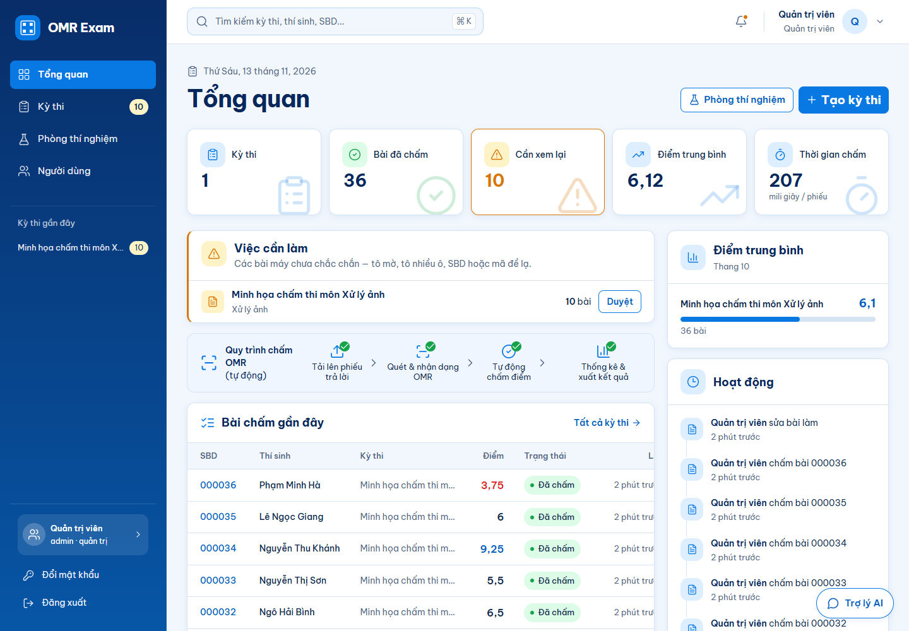
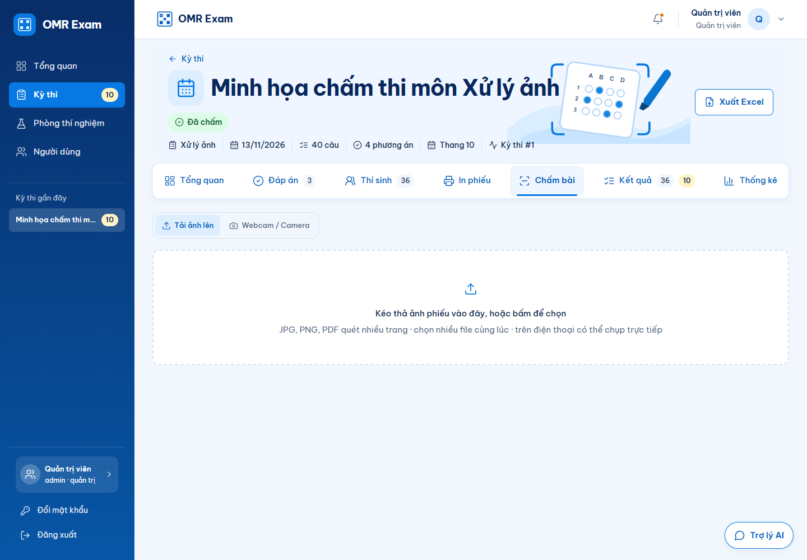
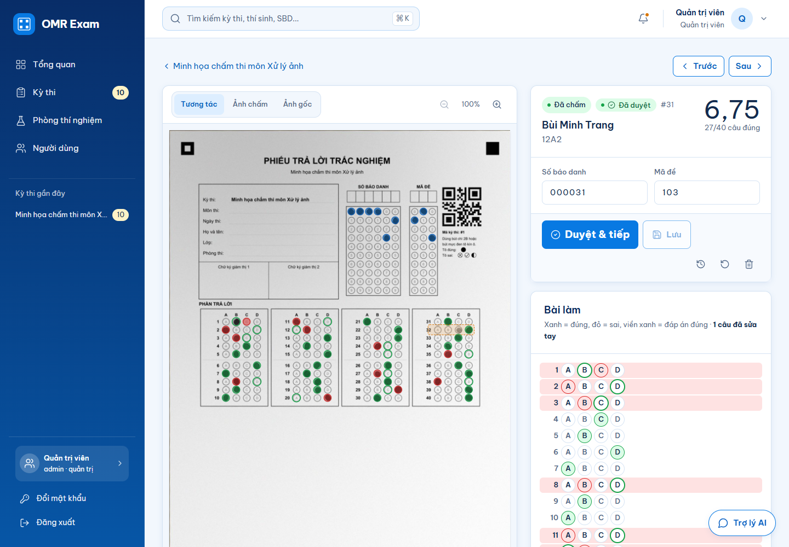
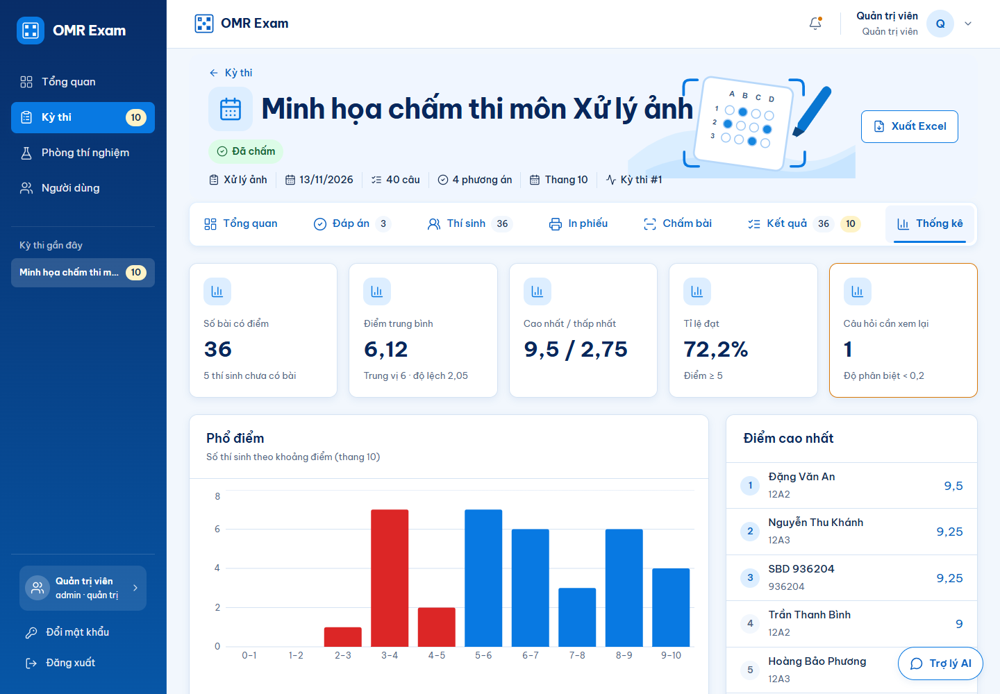
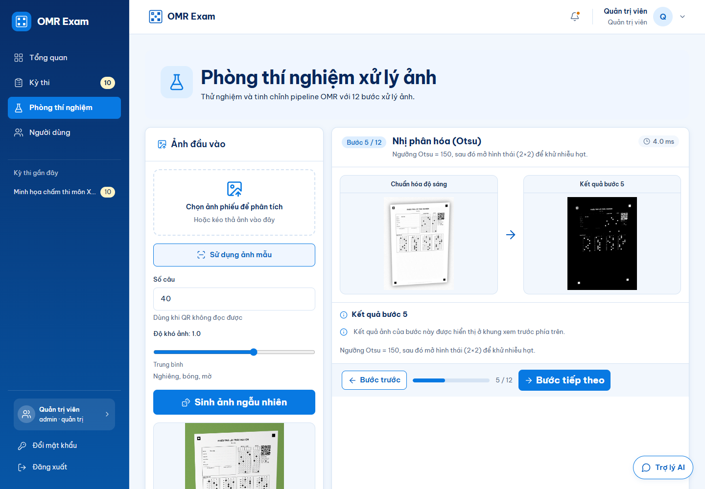
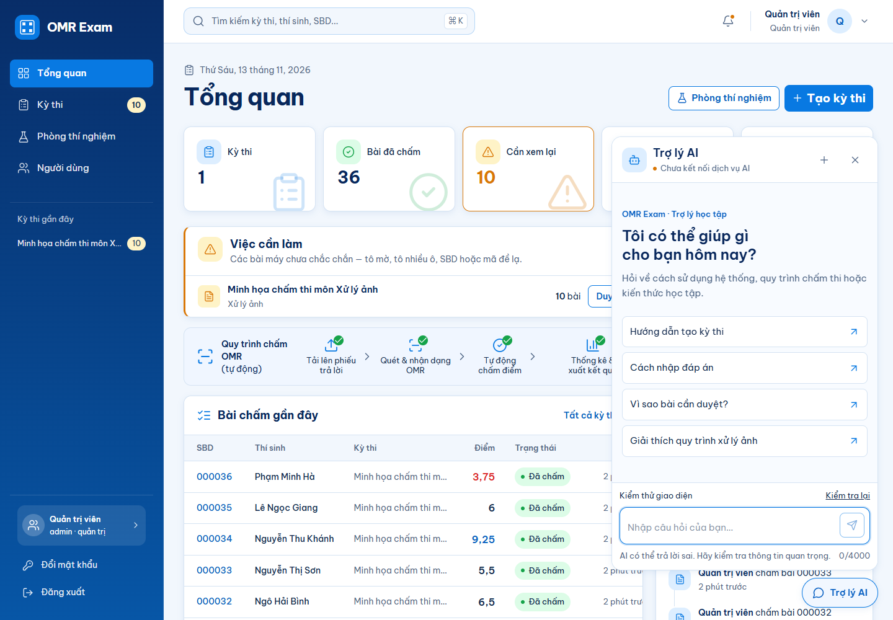
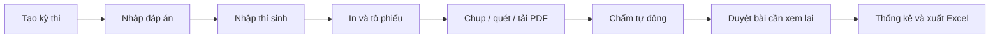
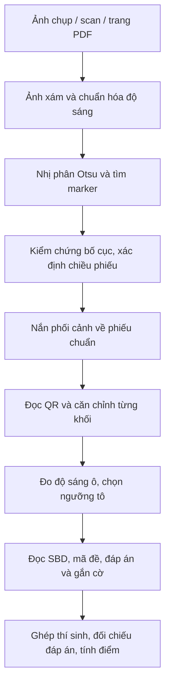

<div align="center">

# OMR Exam

### Từ ảnh chụp phiếu trắc nghiệm đến bảng điểm và phân tích kỳ thi

**Tạo kỳ thi · In phiếu · Chấm tự động · Duyệt bài · Thống kê · Xuất Excel**

Bài tập lớn môn **Xử lý ảnh**, xây dựng với **OpenCV · FastAPI · React · SQLite**.

[Xem demo](#demo) · [Cài đặt](#cai-dat) · [Dùng thử](#dung-thu) · [Hướng dẫn sử dụng](#huong-dan) · [Tài liệu kỹ thuật](#tai-lieu)

</div>



## Hệ thống này làm gì?

**OMR Exam là ứng dụng web giúp giáo viên quản lý kỳ thi và chấm phiếu trả lời trắc nghiệm từ ảnh chụp hoặc file scan.** Giáo viên tạo kỳ thi, nhập đáp án, in phiếu cho thí sinh, sau đó tải ảnh/PDF bài làm lên. Hệ thống đọc số báo danh, mã đề và các ô đã tô, đối chiếu đáp án để tính điểm, đồng thời đánh dấu những bài cần kiểm tra lại.

Ví dụ: với kỳ thi **40 câu, 4 phương án, thang điểm 10**, một bài đúng **32 câu** được **8 điểm**. Nếu phiếu có ô tô mờ, tô nhiều đáp án hoặc mã đề chưa có đáp án, giáo viên có thể mở ảnh, sửa kết quả nhận dạng và duyệt bài trước khi xuất bảng điểm.

**OMR** (*Optical Mark Recognition*) là nhận dạng **dấu tô trong các ô có vị trí đã biết**. SBD và mã đề cũng được đọc từ ô tô trên phiếu; hệ thống không đọc tên viết tay, không chấm tự luận. Luồng chấm bài dùng OpenCV trên máy chủ; chatbot AI là chức năng bổ sung, cần kết nối dịch vụ AI riêng.

| Bạn là… | Bạn có thể dùng dự án để… |
|---|---|
| Giáo viên | Chuẩn bị phiếu thi, chấm hàng loạt, duyệt bài nghi vấn và xuất điểm |
| Quản trị viên | Quản lý tài khoản và xem các kỳ thi trong hệ thống |
| Sinh viên / người học xử lý ảnh | Quan sát từng bước biến ảnh chụp thành dữ liệu đáp án trong Phòng thí nghiệm |
| Người phát triển | Tìm hiểu ứng dụng OMR từ lõi OpenCV đến API, giao diện và kiểm thử |

> **Phạm vi hỗ trợ:** dùng mẫu phiếu do chính OMR Exam sinh ra. Hệ thống chưa hỗ trợ tùy ý mọi mẫu phiếu trắc nghiệm có sẵn.

## Mục lục

- [Ảnh demo](#demo)
- [Chức năng chính](#chuc-nang)
- [Cài đặt và chạy lần đầu](#cai-dat)
- [Dùng thử khi chưa có phiếu thật](#dung-thu)
- [Hướng dẫn sử dụng một kỳ thi](#huong-dan)
- [Quy tắc chấm điểm và trạng thái bài làm](#cham-diem)
- [Cách hệ thống xử lý ảnh](#xu-ly-anh)
- [Công nghệ và cấu trúc mã nguồn](#kien-truc)
- [Chế độ phát triển, cấu hình và triển khai](#cau-hinh)
- [Kiểm thử và đánh giá](#kiem-thu)
- [Lỗi thường gặp](#loi-thuong-gap)
- [Giới hạn hiện tại](#gioi-han)
- [Tài liệu đọc tiếp và tham khảo](#tai-lieu)

<a id="demo"></a>
## Ảnh demo

Các ảnh dưới đây là **ảnh chụp giao diện với dữ liệu minh họa**, được lưu ngay trong [docs/images](docs/images) để hiển thị trực tiếp trên GitHub. Số bài, tên kỳ thi và điểm trong ảnh có thể khác dữ liệu bạn tự sinh khi chạy thử.

### Chấm bài từ ảnh hoặc PDF

Chọn nhiều ảnh/PDF, theo dõi hàng đợi chấm hoặc chuyển sang chế độ webcam.



### Duyệt bài ngay trên ảnh phiếu

Xem ảnh gốc, ảnh chấm và lớp phủ tương tác; kiểm tra SBD, mã đề, từng đáp án và lưu chỉnh sửa.



### Thống kê kết quả kỳ thi

Theo dõi điểm trung bình, tỷ lệ đạt, phổ điểm, thí sinh điểm cao và phân tích câu hỏi.



<details>
<summary><strong>Xem thêm: Phòng thí nghiệm xử lý ảnh và Trợ lý AI</strong></summary>

**Phòng thí nghiệm:** xem ảnh đầu vào/đầu ra theo từng bước, mô tả thuật toán và thời gian xử lý. Ảnh dưới minh họa bước nhị phân hóa Otsu.



**Trợ lý AI:** khung chat tiếng Việt có câu hỏi gợi ý, hỗ trợ Markdown và công thức toán. Ảnh minh họa trạng thái giao diện khi dịch vụ AI chưa kết nối; muốn nhận câu trả lời cần cấu hình và chạy dịch vụ AI.



</details>

<a id="chuc-nang"></a>
## Chức năng chính

| Nhóm | Khả năng hiện có |
|---|---|
| **Kỳ thi** | Tạo, sửa, xóa; cấu hình **1–120 câu**, **2–6 phương án A–F**, thang điểm và điểm đạt |
| **Phiếu trả lời** | Sinh PDF A4 với 4 marker định vị, QR chứa thông tin kỳ thi, SBD 6 số và mã đề 3 số; in phiếu trắng hoặc phiếu cá nhân hóa có tên và SBD tô sẵn |
| **Đáp án** | Quản lý nhiều mã đề; nhập tay, dán chuỗi, nhập Excel/CSV hoặc đọc từ ảnh phiếu đáp án giáo viên đã tô |
| **Thí sinh** | Thêm/sửa danh sách, nhập Excel/CSV, ghép bài làm theo SBD; cảnh báo SBD ngoài danh sách hoặc trùng bài |
| **Chấm bài** | Ảnh JPG/PNG, PDF nhiều trang, chọn nhiều file; giao diện gửi tối đa 3 file đồng thời; webcam tự chụp khi phát hiện phiếu ổn định |
| **Duyệt bài** | Bấm trực tiếp ô trên ảnh để sửa, đổi SBD/mã đề, xem cảnh báo, lịch sử chỉnh sửa và khôi phục kết quả máy |
| **Thống kê** | Phổ điểm, tỷ lệ đạt, theo lớp/mã đề, top thí sinh; độ khó **p**, độ phân biệt **D** theo nhóm 27% và phân bố phương án nhiễu |
| **Xuất kết quả** | Excel gồm bảng điểm, chi tiết bài làm và phân tích câu hỏi khi có dữ liệu |
| **Phòng thí nghiệm** | Tải ảnh hoặc sinh ảnh mẫu, quan sát quy trình xử lý ảnh **12 bước** |
| **Tài khoản** | Admin quản lý người dùng và xem mọi kỳ thi; giáo viên quản lý kỳ thi do mình tạo; đổi mật khẩu |
| **Trợ lý AI** | Hỏi đáp giáo dục và hướng dẫn dùng hệ thống; hội thoại trong tab trình duyệt, hỗ trợ Markdown/công thức; phụ thuộc dịch vụ AI bên ngoài |

<a id="cai-dat"></a>
## Cài đặt và chạy lần đầu

### 1. Chuẩn bị

| Công cụ | Yêu cầu |
|---|---|
| Python | **3.10+**, có thể dùng **3.12** như môi trường đã thử của dự án |
| Node.js và npm | **Node.js 20+** để cài/build frontend |
| Git | Để clone repository; có thể thay bằng **Code → Download ZIP** trên GitHub rồi giải nén |
| Trình duyệt | Trình duyệt hiện đại để mở giao diện; cấp quyền camera nếu dùng webcam |

Node.js chỉ cần cho bước build hoặc phát triển giao diện. Sau khi có `frontend/dist`, Python phục vụ cả giao diện lẫn API trên cùng cổng. Luồng OMR dùng CPU, không yêu cầu GPU hay API key AI.

Các lệnh sau chạy **từng dòng trong PowerShell trên Windows**. Nếu dùng ZIP, bỏ qua lệnh clone và mở terminal tại thư mục đã giải nén.

### 2. Lấy mã nguồn và cài backend

```powershell
git clone https://github.com/NGUYENQUANGCHIEN2701/BaiTapLonXuLyAnh.git
cd BaiTapLonXuLyAnh

python -m venv .venv
.\.venv\Scripts\Activate.ps1
python -m pip install --upgrade pip
python -m pip install -r requirements.txt
```

Nếu PowerShell chặn `Activate.ps1`, có thể tiếp tục bằng Python trong môi trường ảo mà không cần kích hoạt:

```powershell
.\.venv\Scripts\python.exe -m pip install -r requirements.txt
```

Khi đó, ở các lệnh tiếp theo, thay `python` bằng `.\.venv\Scripts\python.exe` khi đứng tại thư mục gốc dự án.

### 3. Build giao diện

```powershell
cd frontend
npm ci
npm run build
cd ..
```

Đầu ra nằm trong `frontend/dist/`. Cần build lại sau khi cập nhật mã frontend.

### 4. Khởi động và đăng nhập

```powershell
python run.py
```

Giữ terminal này chạy, mở **[http://127.0.0.1:8000](http://127.0.0.1:8000)** trên trình duyệt.

| Thông tin đăng nhập ban đầu | Giá trị mặc định |
|---|---|
| Tên đăng nhập | `admin` |
| Mật khẩu | `admin123` |

Tài khoản mặc định được tạo khi khởi động với database chưa có người dùng. Vào **Đổi mật khẩu** để đặt mật khẩu riêng trước khi sử dụng thực tế.

**Chạy thành công khi:** đăng nhập được, thấy trang Tổng quan và mở được mục Kỳ thi. Lần đầu chưa có kỳ thi là bình thường. API kiểm tra hoạt động ở [http://127.0.0.1:8000/api/health](http://127.0.0.1:8000/api/health), trả `{"ok": true}`. Dừng server bằng `Ctrl+C`.

<details>
<summary><strong>Nếu dùng macOS / Linux</strong></summary>

Sau khi clone và vào thư mục dự án:

```bash
python3 -m venv .venv
source .venv/bin/activate
python -m pip install --upgrade pip
python -m pip install -r requirements.txt
cd frontend
npm ci
npm run build
cd ..
python run.py
```

Các bước sử dụng trên trình duyệt giống Windows.

</details>

<a id="dung-thu"></a>
## Dùng thử khi chưa có phiếu thật

### Cách 1 — Sinh demo ngay trên giao diện

Đây là cách thuận tiện nếu bạn vừa cài xong hoặc đã đổi tài khoản/mật khẩu mặc định.

1. Đăng nhập, vào **Kỳ thi → Tạo kỳ thi**.
2. Tạo kỳ thi thử, ví dụ **40 câu, 4 phương án, thang điểm 10**.
3. Mở tab **Tổng quan** của kỳ thi → **Sinh dữ liệu demo**.
4. Chọn số phiếu, ví dụ **20**, rồi bấm sinh. Hệ thống tạo thí sinh, đáp án nếu chưa có, ảnh phiếu mô phỏng và chấm tự động.
5. Mở **Kết quả** để xem điểm, vào bài **Cần xem lại** để thử duyệt, rồi xem **Thống kê** và **Xuất Excel**.

Muốn xem riêng thuật toán mà chưa tạo kỳ thi: vào **Phòng thí nghiệm**, dùng ảnh mẫu hoặc bấm **Sinh ảnh ngẫu nhiên**, sau đó chuyển qua các bước xử lý.

### Cách 2 — Tạo sẵn bộ demo bằng terminal

Mở terminal thứ hai tại thư mục gốc, kích hoạt cùng môi trường ảo rồi chạy:

```powershell
python -m tools.seed_demo
```

Script tạo **2 kỳ thi, 75 bài làm đã chấm**, kèm đáp án, thí sinh và các ca cần duyệt. Chạy xong, tải lại giao diện.

| Tài khoản demo | Mật khẩu | Vai trò |
|---|---|---|
| `admin` | `admin123` | Quản trị viên |
| `giaovien` | `123456` | Giáo viên |

**Lưu ý:** script đăng nhập bằng `admin/admin123` được viết sẵn trong mã, nên phù hợp với môi trường demo mới dùng tài khoản mặc định. Script thêm dữ liệu vào database hiện tại; chạy lại sẽ tạo thêm kỳ thi. Các kỳ thi do script tạo thuộc admin; muốn thử đầy đủ vai trò giáo viên, đăng nhập `giaovien` rồi tự tạo kỳ thi và sinh demo bằng giao diện.

<a id="huong-dan"></a>
## Hướng dẫn sử dụng một kỳ thi



### Bước 1 — Tạo kỳ thi

Vào **Kỳ thi → Tạo kỳ thi**, nhập tên, môn, ngày thi, số câu, số phương án, thang điểm và điểm đạt. Ví dụ: *Kiểm tra Toán 12*, **40 câu**, **A–D**, **thang 10**, **đạt từ 5**.

Mỗi kỳ thi có các tab **Tổng quan · Đáp án · Thí sinh · In phiếu · Chấm bài · Kết quả · Thống kê**.

### Bước 2 — Nhập đáp án theo mã đề

Mở tab **Đáp án**, chọn một trong các cách:

- **Nhập tay:** thêm mã đề, ví dụ `101`, chọn A–F cho từng câu rồi lưu. Có thể dùng bàn phím hoặc dán chuỗi đáp án.
- **Nhập Excel/CSV:** chọn **Nhập từ Excel / ảnh phiếu → Tải file mẫu**, điền đáp án rồi tải lên.
- **Đọc phiếu đáp án:** giáo viên tô mã đề và đáp án lên phiếu trắng, chụp ảnh rồi nhập. **Kiểm tra kết quả nhận dạng và bấm Lưu** để tạo bộ đáp án.

File đáp án dạng cột có cấu trúc sau; mỗi cột sau cột `Câu` là một mã đề:

```csv
Câu,101,102
1,A,B
2,C,A
3,D,C
```

Ví dụ chỉ minh họa 3 câu; file thực tế cần đủ số câu của kỳ thi. Nếu có nhiều mã đề, nhập đủ bộ đáp án tương ứng với các mã thí sinh sẽ tô.

### Bước 3 — Nhập danh sách thí sinh

Mở tab **Thí sinh**, thêm từng người hoặc chọn **Nhập Excel → Tải file mẫu**. Hỗ trợ `.xlsx` và `.csv`, với cấu trúc:

```csv
SBD,Họ tên,Ngày sinh,Lớp,Phòng thi
000001,Nguyễn Văn An,01/01/2008,12A1,P101
000002,Trần Thị Bình,15/03/2008,12A2,P101
```

**SBD và Họ tên là bắt buộc khi nhập danh sách**; các cột còn lại có thể để trống. SBD tối đa 6 chữ số và được thêm số `0` phía trước cho đủ 6 số. Lưu CSV theo UTF-8 để giữ dấu tiếng Việt.

Danh sách thí sinh **không bắt buộc để chấm**. Có danh sách giúp ghép họ tên/lớp, in phiếu cá nhân và phát hiện SBD lạ. Khi chưa nhập danh sách, kết quả chủ yếu được nhận diện theo SBD đọc trên phiếu.

### Bước 4 — In phiếu và tổ chức làm bài

Mở tab **In phiếu**:

- **Phiếu trắng:** chọn số bản → **Mở PDF để in**.
- **Phiếu cá nhân hóa:** cần có danh sách thí sinh; hệ thống in sẵn họ tên, lớp, phòng và tô sẵn SBD.

In khổ **A4, tỷ lệ 100%**, tắt *Fit to page*. Giữ nguyên 4 marker ở góc và vùng QR. Với phiếu trắng, thí sinh cần tô đủ **6 cột SBD**, **3 cột mã đề**, rồi tô một đáp án cho mỗi câu. Các ô số ở đầu phiếu giúp đối chiếu; dữ liệu nhận dạng lấy từ **ô tròn đã tô**.

**Để ảnh dễ đọc:** chụp trọn tờ phiếu, đủ 4 góc, giấy phẳng, ảnh rõ nét, ánh sáng đều; tránh tay che marker hoặc bóng đổ quá đậm.

### Bước 5 — Chấm bài

Vào tab **Chấm bài**, chọn cách nhập:

| Cách nhập | Thao tác |
|---|---|
| **Tải ảnh lên** | Kéo thả/chọn JPG, PNG hoặc PDF; có thể chọn nhiều file |
| **PDF nhiều trang** | Mỗi trang được xử lý thành một bài làm; chuẩn bị một phiếu trên mỗi trang |
| **Webcam / Camera** | Cấp quyền camera, đưa đủ phiếu vào khung và giữ ổn định để tự chụp |
| **Điện thoại** | Truy cập hệ thống rồi dùng nút tải ảnh để chọn ảnh/chụp bằng camera, tùy trình duyệt |

Giới hạn tải lên là **40 MB mỗi file**. Giao diện hiển thị tiến độ và kết quả từng file. Webcam trực tiếp cần `localhost` hoặc HTTPS; xem cách truy cập LAN ở [phần cấu hình](#cau-hinh).

### Bước 6 — Kiểm tra và duyệt bài

Mở tab **Kết quả**, lọc **Cần xem lại**, bấm vào bài cần kiểm tra:

1. Đối chiếu ảnh gốc/ảnh chấm với kết quả nhận dạng.
2. Kiểm tra SBD, mã đề và những câu bị cảnh báo.
3. Bấm vào ô trên ảnh tương tác hoặc trong bảng đáp án để sửa khi cần.
4. Bấm **Lưu** để lưu chỉnh sửa, hoặc **Duyệt & tiếp** để xác nhận bài và chuyển sang bài kế tiếp.

Có thể xem **Lịch sử chỉnh sửa** hoặc **Khôi phục kết quả máy**. Khi duyệt nhiều bài, dùng phím tắt:

| Phím | Thao tác |
|---|---|
| `Ctrl+S` | Lưu chỉnh sửa |
| `Ctrl+Enter` | Duyệt bài |
| `Alt+←` / `Alt+→` | Bài trước / bài sau |

Các lỗi nghiệp vụ như **thiếu đáp án, mã đề lạ, SBD lạ hoặc trùng SBD** cần được xử lý ở dữ liệu tương ứng; xác nhận đã duyệt không tự giải quyết những lỗi này.

### Bước 7 — Xem thống kê và xuất điểm

Vào **Thống kê** để xem phổ điểm, điểm trung bình, tỷ lệ đạt và phân tích câu hỏi. Trong phân tích, **p** là tỷ lệ trả lời đúng; **D** phản ánh chênh lệch tỷ lệ đúng giữa nhóm điểm cao và thấp. Với nhiều mã đề, chọn mã đề cần phân tích.

Bấm **Xuất Excel** trong kỳ thi để tải `.xlsx` gồm:

- **Bảng điểm:** SBD, họ tên, lớp, mã đề, số câu đúng, điểm, kết quả đạt/chưa đạt, trạng thái và ghi chú.
- **Chi tiết bài làm:** đáp án từng câu của từng bài.
- **Phân tích câu hỏi:** khi có dữ liệu phân tích, gồm tỷ lệ đúng, độ khó, độ phân biệt và phân bố lựa chọn.

Nên hoàn tất xử lý các bài **Cần xem lại** trước khi dùng bảng điểm làm kết quả chính thức.

<a id="cham-diem"></a>
## Quy tắc chấm điểm và trạng thái bài làm

```text
Điểm = (Số câu đúng / Số câu của kỳ thi) × Thang điểm
```

Điểm được làm tròn đến **2 chữ số thập phân**. Mỗi câu có trọng số bằng nhau; bỏ trống hoặc tô nhiều phương án tính sai, không trừ thêm điểm. Mã đề được dùng để chọn đúng bộ đáp án; thiếu bộ đáp án tương ứng thì bài chưa có điểm.

| Trạng thái | Ý nghĩa | Cần làm gì? |
|---|---|---|
| **Đã chấm** (`graded`) | Xử lý thành công, không còn cờ yêu cầu duyệt | Có thể xem điểm, thống kê hoặc kiểm tra lại khi cần |
| **Cần xem lại** (`review`) | Có nghi vấn nhận dạng hoặc vấn đề nghiệp vụ; bài có thể đã có điểm tạm | Mở bài, đọc cảnh báo, đối chiếu ảnh và xử lý nguyên nhân |
| **Lỗi** (`error`) | Không xử lý được ảnh, ví dụ không định vị được phiếu | Kiểm tra đúng mẫu phiếu, chụp/quét lại rồi tải lên |

**Đã duyệt** là thông tin xác nhận của người dùng, tách biệt với trạng thái xử lý. Một bài đã duyệt vẫn có thể cần xem lại nếu còn lỗi nghiệp vụ.

<a id="xu-ly-anh"></a>
## Cách hệ thống xử lý ảnh

Phiếu được sinh và đọc theo cùng bố cục trong [omr/layout.py](omr/layout.py). Sau khi tìm được các điểm định vị, hệ thống đưa ảnh chụp về hệ tọa độ của phiếu rồi đo dấu tô tại các vị trí đã biết.



Các kỹ thuật chính:

- **Chuẩn hóa sáng:** ước lượng nền bằng phép đóng hình thái học để giảm ảnh hưởng của bóng đổ và ánh sáng không đều.
- **Tìm marker:** lọc contour gần vuông, chọn bộ 4 điểm và kiểm chứng với hình mẫu; marker trên trái có lỗ trắng giúp xác định chiều phiếu.
- **Nắn phối cảnh:** homography đưa ảnh về kích thước chuẩn **1260 × 1782 px** ở **6 px/mm**; có phương án dự phòng dựa trên mép giấy.
- **Căn chỉnh cục bộ:** template matching bù sai lệch nhỏ ở từng khối trước khi đọc ô.
- **Đọc ô tô:** đo độ sáng trong lõi ô, chọn ngưỡng dựa trên bước nhảy lớn nhất và điều chỉnh cục bộ; gắn cờ ô mơ hồ hoặc tô nhiều.

Phòng thí nghiệm tách các thao tác này thành **12 bước** để quan sát. Xem giải thích từng bước tại [Quy trình xử lý ảnh 12 bước](docs/QUY_TRINH_XU_LY_ANH_12_BUOC.md) và mô tả thuật toán sâu hơn tại [Kiến trúc hệ thống](docs/ARCHITECTURE.md).

<a id="kien-truc"></a>
## Công nghệ và cấu trúc mã nguồn

| Thành phần | Công nghệ |
|---|---|
| Lõi OMR | Python, OpenCV, NumPy |
| Backend | FastAPI, Pydantic, SQLAlchemy, Uvicorn |
| Lưu trữ mặc định | SQLite; ảnh bài làm lưu trên đĩa |
| Frontend | React 19, TypeScript, Vite, Tailwind CSS 4 |
| Dữ liệu và biểu đồ | TanStack Query, Recharts |
| Phiếu và nhập/xuất | ReportLab, PyMuPDF, openpyxl |
| Chatbot | Backend HTTPX gọi dịch vụ AI; React Markdown và KaTeX hiển thị nội dung |
| Kiểm thử | pytest, FastAPI TestClient/HTTPX; Playwright cho giao diện chat |

```text
.
├── omr/                     Lõi xử lý ảnh, độc lập với web
│   ├── layout.py            Bố cục dùng chung cho in và đọc phiếu
│   ├── sheet_pdf.py         Sinh PDF phiếu và mã QR
│   ├── preprocess.py        Chuẩn hóa sáng, nhị phân hóa
│   ├── alignment.py         Marker, chiều phiếu, nắn phối cảnh
│   ├── reader.py            Căn chỉnh khối và đọc các ô tô
│   ├── pipeline.py          Ghép pipeline, diễn giải và tính điểm
│   ├── visualize.py         Vẽ ảnh kết quả
│   └── synth.py             Sinh phiếu đã tô và ảnh chụp mô phỏng
├── app/                     Backend FastAPI
│   ├── routers/             API tài khoản, kỳ thi, bài làm, lab, chat
│   ├── services/            Chấm bài, thống kê, Excel, dịch vụ AI
│   ├── models.py            Mô hình dữ liệu SQLAlchemy
│   ├── schemas.py           Kiểm tra dữ liệu vào/ra
│   └── config.py            Đọc cấu hình từ biến môi trường
├── frontend/                Giao diện React và cấu hình build
├── tools/                   Sinh demo, đánh giá, so sánh OMRChecker
├── tests/                   Kiểm thử backend/API
├── docs/                    Tài liệu và ảnh demo cho README
├── deploy/windows/          Script triển khai Windows
├── data/                    Database, ảnh tải lên, khóa phiên (tự tạo)
├── reference/OMRChecker/    Công cụ tham chiếu (clone riêng khi cần)
├── requirements.txt         Thư viện Python
└── run.py                   Điểm khởi động ứng dụng
```

`data/`, `frontend/dist/`, `frontend/node_modules/` và `reference/` được Git bỏ qua. Các thư mục này xuất hiện khi chạy, build hoặc chuẩn bị môi trường so sánh.

<a id="cau-hinh"></a>
## Chế độ phát triển, cấu hình và triển khai

### Phát triển với tự tải lại

Mở hai terminal, chạy backend tại thư mục gốc và frontend trong `frontend/`:

```powershell
# Terminal 1 — dùng môi trường Python đã cài thư viện
python run.py --reload
```

```powershell
# Terminal 2
cd frontend
npm run dev
```

Mở **http://localhost:5173**. Vite chuyển các request `/api` tới backend ở `127.0.0.1:8000`. Khi đổi cổng backend, cập nhật proxy trong `frontend/vite.config.ts` nếu dùng chế độ này.

### Biến môi trường

| Biến | Mặc định | Mục đích |
|---|---|---|
| `OMR_DATA_DIR` | `data/` ở gốc dự án | Nơi chứa database, ảnh bài làm và khóa phiên |
| `OMR_DATABASE_URL` | SQLite tại `OMR_DATA_DIR/app.db` | Chuỗi kết nối SQLAlchemy |
| `OMR_SECRET_KEY` | Tự sinh, lưu ở `data/secret.key` | Khóa ký phiên đăng nhập |
| `OMR_ADMIN_USER` | `admin` | Tên tài khoản khởi tạo khi chưa có người dùng |
| `OMR_ADMIN_PASSWORD` | `admin123` | Mật khẩu tài khoản khởi tạo |
| `OMR_CHAT_COMPLETIONS_URL` | Endpoint QtedEdu/ngrok trong `app/config.py` | URL API trả lời của chatbot |
| `OMR_CHAT_HEALTH_URL` | Endpoint health trong `app/config.py` | URL kiểm tra dịch vụ AI |
| `OMR_CHAT_API_KEY` | Rỗng | Khóa Bearer nếu dịch vụ AI yêu cầu |

Ví dụ tách dữ liệu thử nghiệm sang thư mục khác, đặt biến **trước khi khởi động**:

```powershell
$env:OMR_DATA_DIR = 'D:\OMR-demo-data'
python run.py
```

Cấu hình đọc từ môi trường của tiến trình, **không tự nạp file `.env`**. Thay đổi biến cần khởi động lại backend. Đổi `OMR_ADMIN_USER`/`OMR_ADMIN_PASSWORD` không thay tài khoản đã có trong database.

### Trợ lý AI

Chatbot cần dịch vụ QtedEdu hoạt động; endpoint ngrok mặc định có thể ngừng hoạt động hoặc thay đổi. Hướng dẫn endpoint, API key, timeout, giới hạn và kiểm thử nằm tại [docs/CHATBOT.md](docs/CHATBOT.md).

Chatbot hiện nhận câu hỏi và lịch sử hội thoại, **chưa đọc database, điểm, danh sách thí sinh hay ảnh**, và chưa thực hiện thao tác chấm/quản trị. Hội thoại lưu theo tài khoản trong `sessionStorage` của tab, không lưu vào database. Dịch vụ AI mất kết nối không cản luồng chấm OMR.

### Truy cập từ điện thoại hoặc máy khác trong LAN

```powershell
python run.py --host 0.0.0.0
```

Cho thiết bị vào cùng mạng, mở `http://<IP-LAN-của-máy-chạy-server>:8000`; cho phép cổng qua firewall nếu cần. Ví dụ máy chủ có IP `192.168.1.10` thì mở `http://192.168.1.10:8000`.

Trên điện thoại truy cập qua HTTP trong LAN, dùng **Tải ảnh lên** để chọn ảnh/chụp ảnh nếu trình duyệt hỗ trợ. Chế độ webcam trực tiếp cần HTTPS hoặc `localhost`.

### Lưu trữ, sao lưu và chạy trên VPS

Với cấu hình mặc định, dữ liệu nằm trong:

```text
data/
├── app.db                  Database SQLite
├── secret.key              Khóa ký phiên đăng nhập
└── uploads/exam_<id>/      Ảnh gốc, ảnh đã nắn và ảnh chấm
```

Để sao lưu nhất quán với SQLite, dừng server rồi sao chép **toàn bộ thư mục dữ liệu**; nếu cấu hình database ngoài, sao lưu database đó riêng cùng thư mục ảnh. Không đưa database, ảnh bài làm thực tế hay khóa truy cập vào Git.

Hướng dẫn chạy nền, firewall, HTTPS và sao lưu trên Windows VPS: [docs/DEPLOY_WINDOWS_VPS.md](docs/DEPLOY_WINDOWS_VPS.md). Đường dẫn, tên miền và thông số máy trong tài liệu triển khai là ví dụ theo môi trường đã ghi nhận, cần thay bằng môi trường của bạn.

<a id="kiem-thu"></a>
## Kiểm thử và đánh giá

### Kiểm thử chức năng

Chạy từ thư mục gốc với môi trường Python đã cài thư viện:

```powershell
python -m pytest tests -q
```

Bộ test kiểm tra luồng API và chatbot bằng database tạm; các bài test chat dùng dịch vụ giả lập, không gọi AI thật. Kiểm tra frontend bằng:

```powershell
cd frontend
npm run build
npx playwright install chromium
npm run test:chat
cd ..
```

Playwright ở đây kiểm tra **giao diện chat** trên desktop/mobile. Hướng dẫn kiểm thử thủ công toàn bộ chức năng, dữ liệu nhập và kết quả mong đợi: [docs/KIEM_THU_CHUC_NANG.md](docs/KIEM_THU_CHUC_NANG.md).

### Đánh giá độ chính xác OMR

Sinh và đánh giá **150 ảnh tổng hợp, 120 câu/phiếu**:

```powershell
python -m tools.evaluate --n 150 --questions 120
```

Script mặc định lưu ảnh, nhãn `truth.json` và kết quả `report.json` trong `dataset/synthetic/`. Bộ ảnh mô phỏng phối cảnh, xoay, bóng đổ, ánh sáng không đều, nhiễu, mờ, nén JPEG, tô nhiều ô, vết tẩy và câu bỏ trống.

**Kết quả đã ghi nhận trong tài liệu dự án** cho bộ dữ liệu tổng hợp trên, không phải cam kết cho ảnh thực tế:

| Chỉ số | Kết quả đã ghi nhận |
|---|---|
| Căn chỉnh thành công | 100% |
| Đọc đúng SBD / mã đề / QR | 100% / 100% / 100% |
| Đọc đúng từng câu | 100% |
| Câu sai không bị gắn cờ | 0 |
| Cờ báo nhầm | 0% |
| Vết tẩy được gắn cờ để duyệt | 74,6% |
| Thời gian xử lý trung bình | Khoảng 150 ms/phiếu trên CPU, tùy môi trường |

Vết tẩy rất nhạt có thể không bị gắn cờ nhưng vẫn được đọc đúng là ô trống. Muốn đo trên ảnh thật, chuẩn bị ảnh và `truth.json` có cùng định dạng với bộ tổng hợp trong thư mục riêng, rồi chạy:

```powershell
python -m tools.evaluate --eval-only --out dataset/real
```

<details>
<summary><strong>So sánh tham khảo với OMRChecker</strong></summary>

Kết quả đã ghi nhận trên **104 ảnh tổng hợp không xoay**, dùng template sinh từ `omr/layout.py`, tiền xử lý `CropOnMarkers` và `sheetToMarkerWidthRatio = 21`:

| Chỉ số | OMRChecker | OMR Exam |
|---|---|---|
| Xử lý được ảnh | 72,1% | 100% |
| Đọc đúng từng câu trên ảnh xử lý được | 94,5% | 100% |
| Phiếu đúng hoàn toàn | 57,7% | 100% |

Để chạy lại, cần clone OMRChecker vào `reference/OMRChecker` và cài các dependency của công cụ theo README của nó, sau đó dùng bộ ảnh đã sinh:

```powershell
git clone https://github.com/Udayraj123/OMRChecker.git reference/OMRChecker
python -m pip install -r reference/OMRChecker/requirements.txt
python -m tools.omrchecker_baseline --data dataset/synthetic
```

Phiếu và dữ liệu được thiết kế cho OMR Exam; OMRChecker là công cụ tổng quát. Các số liệu này chỉ có ý nghĩa trong cấu hình thử nghiệm đã nêu, không đại diện cho mọi mẫu phiếu hoặc điều kiện chụp.

</details>

<a id="loi-thuong-gap"></a>
## Lỗi thường gặp

| Hiện tượng | Cách xử lý |
|---|---|
| `python` hoặc `npm` không được nhận diện | Kiểm tra cài đặt và PATH, mở lại terminal sau khi cài Python/Node.js |
| PowerShell chặn kích hoạt `.venv` | Dùng trực tiếp `.\.venv\Scripts\python.exe` như hướng dẫn cài đặt |
| Trang báo **Chưa build giao diện** | Chạy `npm ci` và `npm run build` trong `frontend/`, sau đó khởi động lại backend |
| Sửa frontend nhưng trình duyệt vẫn thấy bản cũ | Build lại, khởi động lại backend và tải lại trang; hoặc dùng `npm run dev` khi phát triển |
| Cổng 8000 đang được dùng | Chạy `python run.py --port 8001`, mở `http://127.0.0.1:8001` |
| Không đăng nhập được bằng tài khoản mặc định | Kiểm tra tài khoản/mật khẩu đã đổi hoặc biến khởi tạo; mặc định chỉ áp dụng khi chưa có người dùng |
| Script `seed_demo` lỗi đăng nhập | Script dùng cố định `admin/admin123`; chuyển sang sinh demo trên giao diện bằng tài khoản hiện tại |
| Bài chấm không có điểm | Kiểm tra đã nhập đáp án đúng mã đề và mã đề trên phiếu được đọc đúng |
| Bài cứ báo **Cần xem lại** sau khi duyệt | Đọc cảnh báo còn lại, đặc biệt trùng SBD, SBD ngoài danh sách hoặc thiếu mã đề/đáp án |
| Không tìm thấy marker / phiếu | Dùng phiếu do hệ thống sinh, chụp đủ 4 góc, tránh nhòe/bóng đậm, không che marker |
| SBD bị đọc sai | Tô đủ 6 cột số, đối chiếu ảnh khi duyệt; có thể dùng phiếu cá nhân hóa để tô sẵn SBD |
| File tải lên quá lớn | Giảm dung lượng ảnh hoặc tách PDF để mỗi file không vượt 40 MB |
| Camera không mở trên điện thoại | Dùng nút tải ảnh hoặc triển khai HTTPS; kiểm tra quyền camera của trình duyệt |
| Trợ lý AI báo chưa kết nối | Kiểm tra dịch vụ AI, đường hầm ngrok và biến cấu hình theo [tài liệu chatbot](docs/CHATBOT.md) |
| Điện thoại không mở được server qua LAN | Chạy với `--host 0.0.0.0`, kiểm tra IP LAN, cùng mạng và firewall |

<a id="gioi-han"></a>
## Giới hạn hiện tại

- **Mẫu phiếu cố định:** chỉ hỗ trợ bố cục do hệ thống sinh; chưa có trình thiết kế mẫu phiếu tùy ý.
- **Kết quả đánh giá chủ yếu là dữ liệu tổng hợp:** cần thêm ảnh in/chụp thật và nhãn đối chiếu để đánh giá khả năng dùng thực tế.
- **Chất lượng ảnh ảnh hưởng kết quả:** marker bị che, giấy cong nhiều, ảnh quá mờ hoặc bóng đổ đậm có thể cần chụp lại; căn theo mép giấy là phương án dự phòng với độ tin cậy thấp hơn.
- **Quy mô một máy chủ:** chấm bài trong request, SQLite và ảnh lưu cục bộ; tải lớn cần đánh giá thêm và có thể bổ sung hàng đợi nền/database phù hợp.
- **Chatbot phụ thuộc dịch vụ ngoài:** không phải bộ chấm bài và chưa có quyền truy cập dữ liệu kỳ thi.

<a id="tai-lieu"></a>
## Tài liệu đọc tiếp và tham khảo

| Tài liệu | Khi nào nên đọc? |
|---|---|
| [Kiến trúc hệ thống](docs/ARCHITECTURE.md) | Muốn hiểu phân tầng, mô hình dữ liệu, luồng nghiệp vụ, API và thuật toán |
| [Quy trình xử lý ảnh 12 bước](docs/QUY_TRINH_XU_LY_ANH_12_BUOC.md) | Học thuật toán hoặc chuẩn bị báo cáo/thuyết trình |
| [Kiểm thử chức năng](docs/KIEM_THU_CHUC_NANG.md) | Kiểm tra thủ công từng chức năng và đối chiếu mã xử lý |
| [Chatbot Trợ lý AI](docs/CHATBOT.md) | Cấu hình dịch vụ AI, hiểu giới hạn và xử lý lỗi chat |
| [Triển khai Windows VPS](docs/DEPLOY_WINDOWS_VPS.md) | Chạy hệ thống trên máy chủ, thiết lập HTTPS và sao lưu |

Nguồn tham khảo của dự án:

- **Udayraj123/OMRChecker (MIT):** ý tưởng chọn ngưỡng toàn cục/cục bộ theo bước nhảy lớn nhất, `CropOnMarkers` và công cụ đối chiếu; xem thư mục `reference/OMRChecker` sau khi clone theo hướng dẫn trên.
- **N. Otsu (1979):** *A threshold selection method from gray-level histograms* — cơ sở của bước nhị phân hóa.
- **R. L. Ebel (1972):** thang đánh giá độ phân biệt câu hỏi.
- **OpenCV:** các hàm xử lý contour, biến đổi phối cảnh, template matching và đọc QR được sử dụng trong lõi OMR.
