# Tài liệu kiến trúc — OMR Exam

> Hệ thống quản lý kỳ thi và chấm bài trắc nghiệm bằng xử lý ảnh.
> Tài liệu này mô tả hệ thống gồm những phần nào, dữ liệu đi qua chúng ra sao, và vì sao lại thiết kế như vậy.
> Đọc theo thứ tự từ trên xuống: tổng quan → các luồng nghiệp vụ → chi tiết lõi xử lý ảnh → tham chiếu.

## Mục lục

1. [Tổng quan](#1-tổng-quan)
2. [Kiến trúc tổng thể](#2-kiến-trúc-tổng-thể)
3. [Cấu trúc mã nguồn](#3-cấu-trúc-mã-nguồn)
4. [Mô hình dữ liệu](#4-mô-hình-dữ-liệu)
5. [Các luồng nghiệp vụ chính](#5-các-luồng-nghiệp-vụ-chính)
6. [Lõi xử lý ảnh OMR](#6-lõi-xử-lý-ảnh-omr)
7. [Trạng thái bài làm và hệ thống cờ](#7-trạng-thái-bài-làm-và-hệ-thống-cờ)
8. [Backend: API, bảo mật, lưu trữ](#8-backend-api-bảo-mật-lưu-trữ)
9. [Frontend](#9-frontend)
10. [Kiểm thử và đánh giá](#10-kiểm-thử-và-đánh-giá)
11. [Chạy, cấu hình, triển khai](#11-chạy-cấu-hình-triển-khai)
12. [Giới hạn đã biết và hướng mở rộng](#12-giới-hạn-đã-biết-và-hướng-mở-rộng)

---

## 1. Tổng quan

### 1.1 Bài toán

Giáo viên cần tổ chức một bài thi trắc nghiệm: in phiếu, thu bài, chấm điểm, xử lý các bài bất thường (tô mờ,
tô hai ô, ghi sai số báo danh) và tổng hợp kết quả. Chấm tay chậm và dễ sai; máy chấm OMR chuyên dụng thì đắt và
cần giấy in riêng. Hệ thống này dùng **ảnh chụp bằng điện thoại / webcam / máy scan** của phiếu in trên giấy
thường, rồi dùng xử lý ảnh để đọc kết quả.

### 1.2 Phạm vi chức năng

| Nhóm | Chức năng |
|---|---|
| Kỳ thi | Tạo/sửa/xóa kỳ thi: số câu (1–120), số phương án (2–6), thang điểm, điểm đạt |
| Phiếu trả lời | Sinh PDF A4 có marker định vị + mã QR; in phiếu trắng hoặc phiếu cá nhân hóa (in sẵn tên, tô sẵn SBD) |
| Đáp án | Nhiều mã đề mỗi kỳ thi; nhập tay, dán chuỗi, Excel/CSV, hoặc chụp phiếu do giáo viên tô |
| Thí sinh | Nhập Excel/CSV; tự ghép bài làm với thí sinh theo số báo danh |
| Chấm bài | Tải nhiều ảnh/PDF cùng lúc, hoặc dùng webcam tự chụp khi thấy phiếu |
| Duyệt bài | Xem ảnh phiếu đã nắn, bấm trực tiếp lên ô để sửa, lưu lịch sử chỉnh sửa |
| Thống kê | Phổ điểm, theo lớp, theo mã đề, độ khó và độ phân biệt từng câu |
| Xuất | File Excel: bảng điểm, chi tiết bài làm, phân tích câu hỏi |
| Phòng thí nghiệm | Hiển thị từng bước của thuật toán xử lý ảnh trên một ảnh bất kỳ |

### 1.3 Nguyên tắc thiết kế

1. **Lõi xử lý ảnh tách biệt hoàn toàn với web.** Thư mục `omr/` không biết gì về cơ sở dữ liệu hay HTTP; nó chỉ
   nhận một ảnh và trả về kết quả. Nhờ vậy có thể kiểm thử, đánh giá và trình bày thuật toán độc lập.
2. **Một nguồn tọa độ duy nhất.** Vị trí mọi ô tròn được định nghĩa một lần trong `omr/layout.py` (đơn vị mm),
   dùng chung cho cả bước *in phiếu* và bước *đọc phiếu*. Không bao giờ có chuyện phiếu in ra lệch với template.
3. **Máy không chắc thì hỏi người.** Thay vì đoán, hệ thống gắn cờ những chỗ không chắc chắn và đưa bài vào hàng
   đợi "cần xem lại". Giáo viên chỉ phải nhìn những bài đó.
4. **Không phá kết quả gốc.** Bài làm lưu song song *kết quả máy đọc* và *kết quả cuối cùng* (sau khi sửa tay),
   kèm nhật ký ai sửa gì — phục vụ phúc tra.
5. **Chạy được trên một máy tính bình thường.** Một tiến trình Python duy nhất, CSDL SQLite, không cần GPU,
   không cần dịch vụ ngoài.

---

## 2. Kiến trúc tổng thể

### 2.1 Sơ đồ các tầng

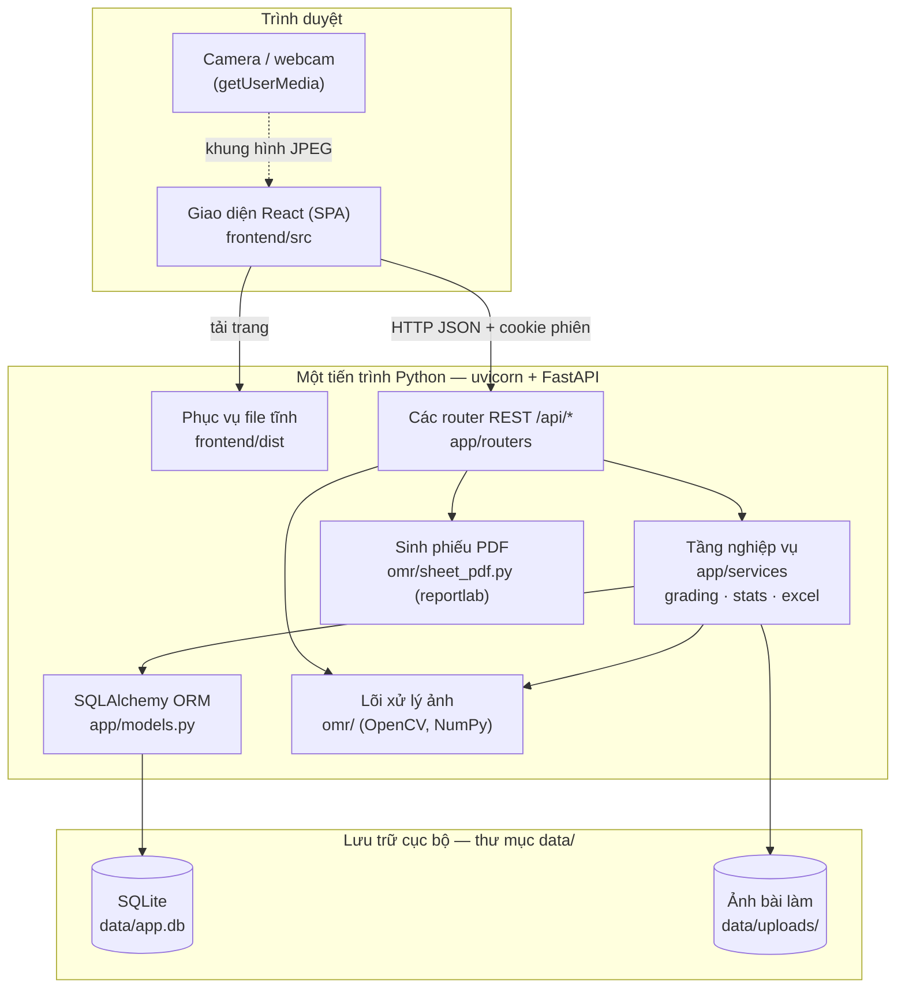

**Đọc sơ đồ:** trình duyệt chỉ nói chuyện với một máy chủ duy nhất. Máy chủ vừa trả giao diện (file tĩnh đã
build), vừa trả API. Khi có ảnh bài làm, router gọi tầng nghiệp vụ; tầng nghiệp vụ gọi lõi `omr/` để đọc ảnh,
rồi ghi kết quả vào SQLite và lưu ảnh vào ổ đĩa.

### 2.2 Công nghệ sử dụng

| Tầng | Công nghệ | Lý do chọn |
|---|---|---|
| Xử lý ảnh | OpenCV 4, NumPy | Thư viện chuẩn của ngành, đủ mọi phép toán cần dùng |
| Sinh phiếu | reportlab, PyMuPDF | reportlab vẽ PDF vector chính xác tới mm; PyMuPDF đổi PDF ↔ ảnh |
| Web server | FastAPI, uvicorn | Khai báo API ngắn gọn, tự kiểm tra dữ liệu vào bằng Pydantic |
| CSDL | SQLite + SQLAlchemy 2 | Không cần cài đặt; một file duy nhất, dễ nộp bài/sao lưu |
| Excel | openpyxl | Đọc/ghi .xlsx có định dạng |
| Giao diện | React 19, Vite, TypeScript | Giao diện tương tác (lớp phủ bấm được, webcam, biểu đồ) |
| Style | Tailwind CSS 4 | Viết style ngay tại component, bảng màu tập trung ở `index.css` |
| Gọi API, cache | TanStack Query | Tự quản lý tải/cache/làm mới dữ liệu |
| Biểu đồ | Recharts | Biểu đồ cột, tán xạ, vùng |

---

## 3. Cấu trúc mã nguồn

```
BTLXuLyAnh/
├── omr/                      LÕI XỬ LÝ ẢNH — không phụ thuộc web
│   ├── layout.py             Bố cục phiếu: tọa độ (mm) của marker, ô SBD, mã đề, câu hỏi; mã hóa QR
│   ├── sheet_pdf.py          Vẽ phiếu ra PDF (phiếu trắng / cá nhân hóa), đổi PDF → PNG
│   ├── preprocess.py         Ảnh xám, ước lượng nền, chuẩn hóa độ sáng, nhị phân Otsu
│   ├── alignment.py          Tìm marker, chọn bộ 4 điểm, kiểm chứng, homography, dự phòng theo mép giấy
│   ├── reader.py             Căn chỉnh tinh từng khối, đo độ sáng ô, chọn ngưỡng, đánh dấu không chắc chắn
│   ├── pipeline.py           Ghép tất cả: process_image() → OMRResult; score_answers(); load_image_bytes()
│   ├── visualize.py          Vẽ ảnh kết quả (đúng/sai/cần xem), vẽ bước phát hiện marker
│   └── synth.py              Sinh dữ liệu giả: tô phiếu + mô phỏng ảnh chụp điện thoại
│
├── app/                      BACKEND
│   ├── config.py             Đường dẫn, chuỗi kết nối CSDL, khóa bí mật, tài khoản mặc định
│   ├── db.py                 Engine SQLAlchemy, phiên làm việc, bật WAL/khóa ngoại cho SQLite
│   ├── models.py             Bảng: User, Exam, AnswerKey, Student, Submission, AuditLog
│   ├── schemas.py            Kiểu dữ liệu vào/ra của API (Pydantic)
│   ├── security.py           Băm mật khẩu, tạo/kiểm tra cookie phiên, phân quyền
│   ├── main.py               Tạo app, gắn router, phục vụ giao diện, tạo bảng + admin lần đầu
│   ├── routers/
│   │   ├── auth.py           Đăng nhập/đăng xuất, đổi mật khẩu, quản lý người dùng
│   │   ├── exams.py          Kỳ thi, đáp án, thí sinh, in phiếu, thống kê, xuất Excel, nhật ký
│   │   ├── submissions.py    Tải bài lên, danh sách, chi tiết, sửa tay, khôi phục, xóa, ảnh
│   │   ├── lab.py            Phòng thí nghiệm, phát hiện marker cho webcam, ảnh mẫu, dữ liệu demo
│   │   └── dashboard.py      Số liệu trang Tổng quan
│   └── services/
│       ├── grading.py        Chấm một ảnh → bài làm; tính điểm; ghép thí sinh; xác định trạng thái
│       ├── stats.py          Thống kê điểm, phân tích câu hỏi
│       └── excel.py          Đọc danh sách/đáp án; xuất bảng điểm
│
├── frontend/                 GIAO DIỆN
│   └── src/
│       ├── main.tsx          Điểm vào: nạp font, QueryClient, Router, AuthProvider
│       ├── App.tsx           Khai báo tuyến trang (route)
│       ├── lib/              api.ts (gọi HTTP), auth.tsx, types.ts, utils.ts
│       ├── components/       ui.tsx (bộ component dùng chung), Layout.tsx, ExamForm.tsx
│       └── pages/            Mỗi trang một file; pages/exam/ là các tab của một kỳ thi
│
├── tools/                    CÔNG CỤ DÒNG LỆNH
│   ├── evaluate.py           Sinh bộ dữ liệu tổng hợp và đo độ chính xác
│   ├── omrchecker_baseline.py  Chạy OMRChecker trên cùng dữ liệu để so sánh
│   └── seed_demo.py          Tạo dữ liệu demo
├── tests/test_api.py         Kiểm thử API toàn luồng
├── run.py                    Lệnh khởi động server
├── data/                     (tự sinh, không commit) CSDL, ảnh, khóa bí mật
└── reference/OMRChecker/     (không commit) repo tham khảo
```

**Quy tắc phụ thuộc** — mũi tên chỉ hướng "được phép import":

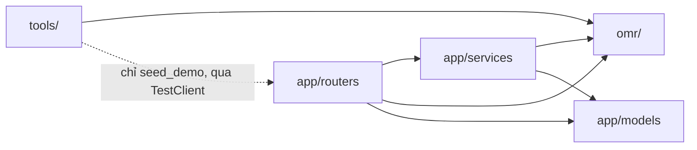

`omr/` không bao giờ import gì từ `app/`. Nếu cần thông tin của kỳ thi (số câu, số phương án), tầng gọi phải
truyền vào dưới dạng tham số.

---

## 4. Mô hình dữ liệu

### 4.1 Sơ đồ quan hệ

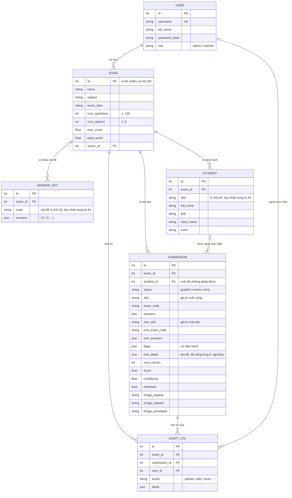

### 4.2 Những điểm cần lưu ý

- **Hai bộ giá trị trong `Submission`.** Các cột `omr_*` là những gì máy đọc được lúc tải ảnh lên và **không bao giờ
  bị sửa**. Các cột `sbd`, `exam_code`, `answers` là giá trị cuối cùng dùng để tính điểm; người chấm sửa các cột này.
  Nút "Khôi phục kết quả máy" chỉ đơn giản là chép `omr_*` đè lên.
- **`omr_detail` (JSON)** lưu cho từng ô: tâm (px trên ảnh đã nắn), bán kính, độ sáng đo được, ngưỡng, máy có cho
  là đã tô không. Giao diện dùng dữ liệu này để vẽ lớp phủ bấm được mà không phải chạy lại xử lý ảnh. Trong đó còn
  có `flags` (cờ gốc của máy) và `resolved` (danh sách trường người chấm đã sửa — cờ của các trường này không hiện nữa).
- **`student_id` có thể rỗng.** Bài làm vẫn được lưu và chấm kể cả khi SBD không có trong danh sách; khi danh sách
  thí sinh thay đổi, hệ thống ghép lại.
- **Xóa theo dây chuyền.** Xóa kỳ thi sẽ xóa đáp án, thí sinh, bài làm, nhật ký và thư mục ảnh của kỳ thi đó.

---

## 5. Các luồng nghiệp vụ chính

### 5.1 Vòng đời một kỳ thi

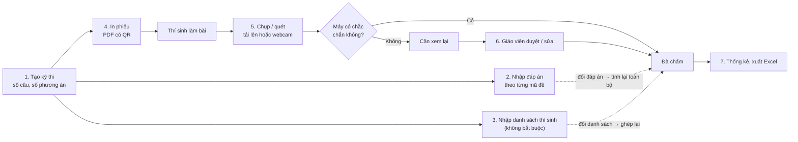

Bước 2 và 3 có thể làm **trước hoặc sau** khi chấm. Bài làm tải lên khi chưa có đáp án vẫn được đọc và lưu,
chỉ chưa có điểm; ngay khi đáp án được lưu, mọi bài làm được tính lại.

### 5.2 Đăng nhập

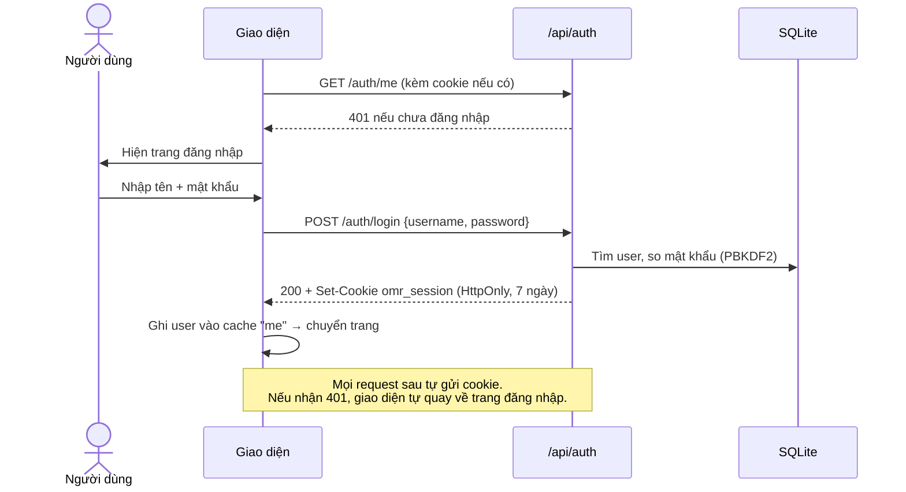

### 5.3 In phiếu trả lời

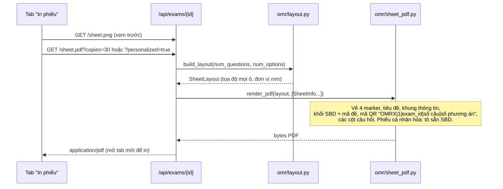

### 5.4 Chấm bài từ ảnh tải lên (luồng quan trọng nhất)

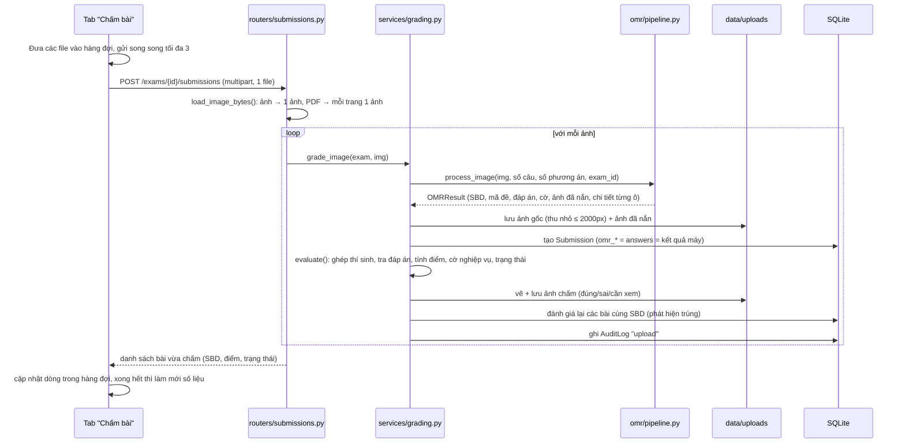

Mỗi phiếu mất khoảng 150 ms trên CPU. Các endpoint có xử lý ảnh được khai báo bằng hàm thường (`def`, không
`async def`), nên FastAPI chạy chúng trong thread pool; OpenCV nhả khóa GIL khi tính toán nên nhiều ảnh được chấm
song song thật sự (đo thử: 6 request đồng thời mất ~1 s, so với ~2,5 s nếu chạy tuần tự) và server vẫn trả lời
các request khác trong lúc chấm.

### 5.5 Chấm bằng webcam

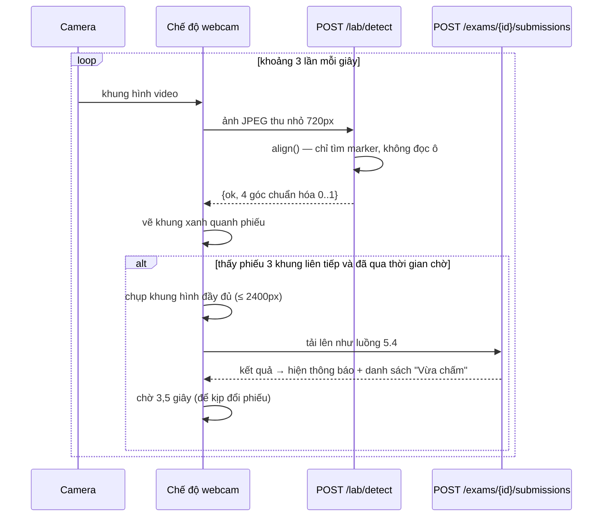

### 5.6 Duyệt và sửa bài làm

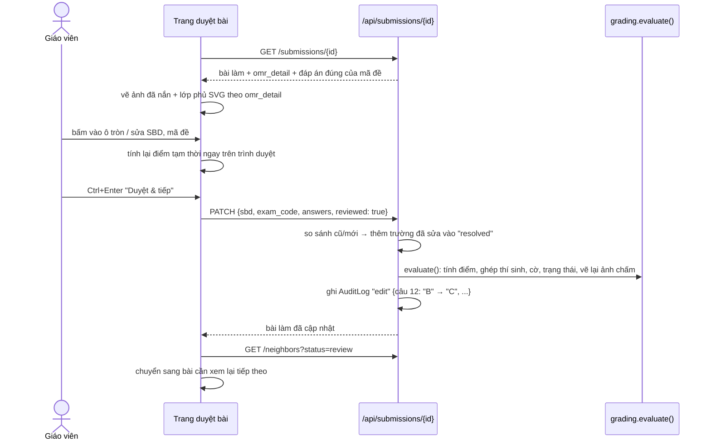

### 5.7 Thay đổi đáp án hoặc danh sách thí sinh

Mọi thao tác lưu/xóa mã đề, thêm/sửa/xóa/nhập thí sinh, hay đổi thang điểm đều gọi `refresh_exam(exam)`:
duyệt qua tất cả bài làm của kỳ thi, chạy lại `evaluate()` cho từng bài (tính điểm, ghép thí sinh, cờ, vẽ lại
ảnh chấm). **Không chạy lại xử lý ảnh** — chỉ dùng kết quả đọc đã lưu, nên rất nhanh.

### 5.8 Thống kê và xuất Excel

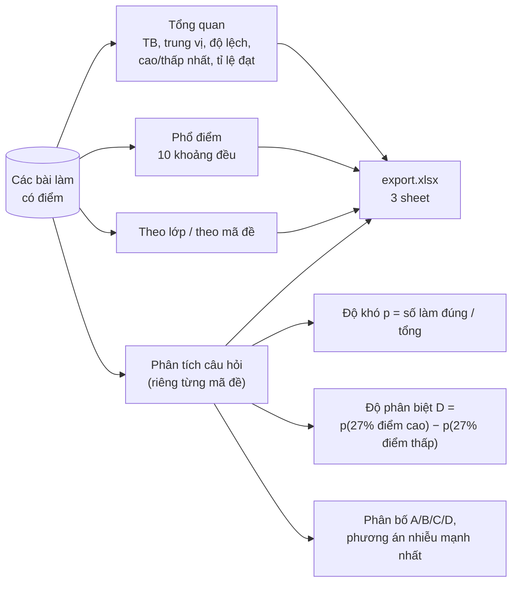

Phân tích câu hỏi tính **riêng cho từng mã đề**, vì các mã đề thường đảo thứ tự câu: "câu 5" của đề 101 và đề 102
là hai câu hỏi khác nhau. Đánh giá độ phân biệt theo thang Ebel: ≥ 0,4 rất tốt, ≥ 0,3 tốt, ≥ 0,2 tạm được, < 0,2 kém.

---

## 6. Lõi xử lý ảnh OMR

Đây là phần chính của môn học. Toàn bộ nằm trong `omr/`, gọi qua một hàm duy nhất:

```python
from omr import process_image
result = process_image(image_bgr, num_questions=50, num_options=4, expected_exam_id=1)
result.sbd, result.exam_code, result.answers, result.flags, result.confidence
```

### 6.1 Thiết kế phiếu — nền móng của mọi bước sau

Vì phiếu do chính hệ thống sinh ra, ta **biết trước chính xác** vị trí từng ô (đơn vị mm trên khổ A4
210 × 297 mm). Bài toán đọc phiếu vì thế quy về: *đưa ảnh chụp về đúng hệ tọa độ mm đó*, sau đó chỉ việc đo độ
sáng tại các vị trí đã biết.

```
 (11,11) ■□                                       ■ (199,11)      ■ marker vuông đặc 8×8 mm
         ┌──────────────┐  SỐ BÁO DANH  MÃ ĐỀ  ┌───┐               □ marker góc trên-trái có lỗ trắng
         │ Kỳ thi ...   │  ○○○○○○       ○○○    │QR │                 → biết chiều phiếu khi ảnh bị xoay
         │ Họ tên ...   │  ○○○○○○       ○○○    └───┘
         │ ...          │  (10 hàng 0–9)       QR: "OMRX|1|exam_id|số câu|số phương án"
         └──────────────┘
         PHẦN TRẢ LỜI
         ┌────────┐┌────────┐┌────────┐┌────────┐   4 cột, mỗi cột tối đa 30 câu,
         │1 ○○○○  ││31 ○○○○ ││61 ○○○○ ││91 ○○○○ │   nhóm 5 câu cách nhau thêm 2 mm
         │...     ││...     ││...     ││...     │   ô câu hỏi: bán kính 2,1 mm
         └────────┘└────────┘└────────┘└────────┘   ô SBD/mã đề: bán kính 2,0 mm
 (11,286)■                                        ■ (199,286)
```

Các thông số nằm ở đầu `omr/layout.py`. `build_layout(num_questions, num_options)` trả về `SheetLayout` gồm các
`FieldBlock` (khối SBD, khối mã đề, mỗi cột câu hỏi là một khối); mỗi khối có danh sách "mục" (một chữ số SBD
hoặc một câu hỏi), mỗi mục là danh sách các ô tròn `Bubble(x, y, r, label)`.

### 6.2 Toàn cảnh pipeline

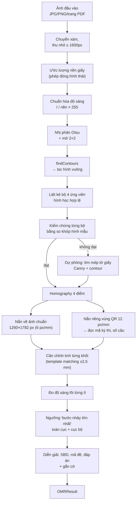

Mỗi ô dưới đây tương ứng một hàm cụ thể. Có thể xem trực quan từng bước trên trang **Phòng thí nghiệm** của web.

### 6.3 Bước 1 — Tiền xử lý (`preprocess.py`)

**Vấn đề:** ảnh chụp điện thoại luôn có ánh sáng không đều: một góc sáng, một góc tối, bóng tay hoặc bóng điện
thoại đổ lên giấy. Nếu dùng một ngưỡng cố định, vùng tối sẽ bị coi là "đã tô".

**Cách làm — loại bỏ nền:**

1. `estimate_background()`: thu nhỏ ảnh 4 lần, áp **phép đóng hình thái học** (giãn rồi co) với phần tử cấu trúc
   hình elip có kích thước ≈ 6% cạnh ngắn của ảnh. Phép giãn lấy giá trị lớn nhất trong cửa sổ, nên các nét mực
   nhỏ hơn cửa sổ (chữ, ô tô, marker) biến mất, chỉ còn lại "độ sáng của giấy" tại mỗi vùng. Làm mờ Gauss rồi
   phóng lại kích thước gốc.
2. `normalize_illumination()`: chia từng điểm ảnh cho nền: `I' = I / nền × 255`. Giấy trắng ở bất kỳ vùng nào
   cũng thành ≈ 255, mực vẫn tối — bóng đổ bị triệt tiêu.
3. `binarize_dark()`: ngưỡng Otsu trên ảnh đã chuẩn hóa, nhưng **kẹp ngưỡng trong [60, 150]** để không bị lệch quá
   khi ảnh gần như toàn trắng hoặc có vùng tối lớn. Kết quả: mực = 255, giấy = 0. Sau đó mở hình thái 2×2 để xóa
   nhiễu hạt.

### 6.4 Bước 2 — Tìm và chọn 4 marker (`alignment.py`)

**2a. Lọc ứng viên** — `find_marker_candidates()`: với mỗi contour ngoài cùng trên ảnh nhị phân, giữ lại nếu:

| Điều kiện | Ngưỡng | Loại bỏ cái gì |
|---|---|---|
| Diện tích | ≥ max(40 px, 0,004% ảnh) và ≤ 2% ảnh | nhiễu nhỏ, vùng nền lớn |
| Tỉ lệ cạnh hình chữ nhật bao nhỏ nhất | ≥ 0,6 | nét kẻ, chữ dài |
| Độ đặc (diện tích / bao lồi) | ≥ 0,9 | hình lõm, chữ |
| Xấp xỉ đa giác (sai số 5% chu vi) | đúng 4 đỉnh | hình nhiều cạnh |
| Diện tích đa giác 4 đỉnh / diện tích contour | ≥ 0,86 | **các ô tròn đã tô** |

Điều kiện cuối là mấu chốt: nếu xấp xỉ một hình tròn bằng 4 đỉnh, ta được hình vuông nội tiếp có diện tích
2r² so với πr² của hình tròn, tỉ số chỉ khoảng 0,64. Với hình vuông thật (kể cả bị nghiêng phối cảnh) tỉ số ≈ 1.

Với mỗi ứng viên còn đo thêm `ink_center` — tỉ lệ điểm mực ở vùng tâm. Marker đặc ≈ 1, marker rỗng (góc
trên-trái) ≈ 0.

**2b. Liệt kê bộ 4** — `marker_quads()`: lấy tối đa 18 ứng viên lớn nhất, duyệt mọi tổ hợp 4 điểm (≤ 3060 tổ hợp),
sắp các điểm theo chiều kim đồng hồ, giữ tổ hợp nếu:

- tứ giác lồi;
- kích thước 4 marker không chênh nhau quá ~2 lần;
- hai cặp cạnh đối dài tương đương (tỉ số ≥ 0,6 — cho phép phối cảnh);
- tỉ lệ khung ≈ 188 : 275 (khoảng cách giữa tâm các marker), sai lệch tối đa 30%, theo cả chiều dọc lẫn ngang;
- cạnh marker so với cạnh ngắn của khung nằm trong 2,2%–7,5% (thực tế 8/188 ≈ 4,3%).

Sắp các tổ hợp theo **diện tích giảm dần** (marker thật nằm ngoài cùng nên tạo tứ giác lớn nhất), giữ 8 tổ hợp đầu.

**2c. Kiểm chứng và xác định chiều** — `select_markers()`: với mỗi tổ hợp, thử 2 cách gán góc trên-trái (2 trong 4
cách xoay vòng; 2 cách còn lại bị loại vì cạnh trên phải là cạnh ngắn). Với mỗi cách:

1. Tính homography đưa 4 điểm về vị trí marker chuẩn ở độ phân giải thấp 3 px/mm.
2. Nắn ảnh đã chuẩn hóa sáng theo homography đó.
3. So với **hình mẫu các phần cố định** của mọi phiếu (4 marker — có lỗ ở góc trên-trái —, khung khối SBD, khối mã
   đề, khung thông tin) bằng tương quan chéo chuẩn hóa `TM_CCOEFF_NORMED`.

Chọn cách có điểm cao nhất; dừng sớm khi điểm > 0,6; từ chối nếu điểm tốt nhất < 0,3. Vì hình mẫu có lỗ trắng ở
marker trên-trái, cách gán đúng chiều luôn khớp hơn — đây là cách hệ thống **tự nhận phiếu bị xoay 90/180/270°**.

**2d. Dự phòng** — nếu không tìm được bộ marker nào: dò mép tờ giấy (`find_page_quad()`: làm mờ, Canny, giãn,
contour lớn nhất có xấp xỉ 4 đỉnh và chiếm ≥ 20% ảnh), thử 4 cách xoay bằng cùng phép kiểm chứng, nắn sơ bộ cả tờ
giấy rồi tìm marker lần nữa trên ảnh đã nắn. Nếu vẫn không thấy marker thì dùng thẳng 4 góc tờ giấy, kèm cảnh báo
và giảm độ tin cậy.

### 6.5 Bước 3 — Nắn phối cảnh

Từ 4 cặp điểm (tâm marker trên ảnh ↔ tọa độ chuẩn `MARKER_CENTERS × 6 px/mm`) giải ma trận homography 3×3 bằng
`cv2.getPerspectiveTransform`, rồi `cv2.warpPerspective` ra ảnh chuẩn **1260 × 1782 px**. Từ đây mọi tọa độ mm
nhân 6 là ra pixel.

Vùng mã QR được nắn **riêng ở 12 px/mm** (ghép ma trận tỉ lệ + tịnh tiến vào homography) để các module QR đủ lớn
cho `cv2.QRCodeDetector`; thử cả ảnh gốc lẫn ảnh nhị phân Otsu. QR cho biết phiếu thuộc kỳ thi nào và in cho bao
nhiêu câu — nếu khác kỳ thi đang chấm, bài bị gắn cờ "phiếu thuộc kỳ thi khác".

### 6.6 Bước 4 — Căn chỉnh tinh từng khối (`reader.align_block`)

Homography 4 điểm coi tờ giấy là một mặt phẳng tuyệt đối. Giấy thật thì cong, nhăn, nên phần giữa phiếu có thể
lệch 1–2 mm so với tính toán — đủ để đo nhầm sang viền ô bên cạnh.

Với từng khối (khối SBD, khối mã đề, mỗi cột câu hỏi):

1. Vẽ "hình lý thuyết" của khối: khung viền + vòng tròn các ô, nét dày 0,25 mm, làm mờ nhẹ.
2. Tạo "ảnh mực" từ ảnh đã nắn: `255 − ảnh chuẩn hóa`, làm mờ nhẹ.
3. `cv2.matchTemplate` trong phạm vi ±2,5 mm quanh vị trí lý thuyết.
4. Nếu điểm khớp ≥ 0,25: dịch toàn khối theo (dx, dy) tìm được; nếu không: giữ nguyên.

Ý tưởng tương tự tùy chọn `auto_align` của OMRChecker, nhưng dùng template matching thay cho phép biến đổi hình
thái theo cột.

### 6.7 Bước 5 — Đo độ sáng ô

Với mỗi ô, lấy **trung bình mức xám trong hình tròn bán kính 62% bán kính ô** trên ảnh đã chuẩn hóa sáng. Chỉ lấy
lõi để không tính viền in của ô. Kết quả: ô trống ≈ 220–245 (có chữ cái in mờ bên trong), ô tô bút chì ≈ 40–120.

### 6.8 Bước 6 — Chọn ngưỡng "bước nhảy lớn nhất"

Kế thừa ý tưởng `get_global_threshold` / `get_local_threshold` của OMRChecker.

**Ngưỡng toàn cục:** sắp xếp tăng dần độ sáng **của mọi ô trên phiếu**. Ô tô và ô trống tạo thành hai cụm, giữa
chúng là một "khoảng trống". Tìm vị trí có hiệu `q[i+2] − q[i]` lớn nhất (bước 2 để chịu được một giá trị nhiễu
nằm giữa) — ngưỡng đặt ở giữa khoảng đó. Nếu bước nhảy lớn nhất < 25 (`min_jump`) thì coi như phiếu không có ô
nào được tô rõ và dùng ngưỡng mặc định 175.

```
độ sáng
 255 ┤                          ▄▄▄▄▄▄▄▄▄▄▄▄▄▄▄▄▄▄▄▄▄▄▄  ← ô trống
     │                         █
 130 ┤- - - - - - - - - - - - -█- - - - - - - - - - -  ← ngưỡng (giữa bước nhảy)
     │                         █
  60 ┤▁▁▂▂▂▃▃▃▃▄▄▄▄▄▄▄▄▄▄▄▄▄▄▄▄█                        ← ô đã tô
     └────────────────────────────────────────────────── thứ tự ô (đã sắp xếp)
```

**Ngưỡng cục bộ:** với từng câu (hoặc từng chữ số SBD), tìm bước nhảy lớn nhất trong riêng các ô của nó (bước 1).
Nếu bước nhảy ≥ 30 thì dùng ngưỡng cục bộ, nhưng **kẹp trong ± 22% bước nhảy toàn cục quanh ngưỡng toàn cục**.
Lý do kẹp: ví dụ một câu có một ô tô đậm (60) và một vết tẩy (190), ba ô còn lại trống (240) — ngưỡng cục bộ tự do
sẽ rơi vào khoảng 215 và coi vết tẩy là đã tô; kẹp lại thì vết tẩy vẫn được coi là trống.

Ô có độ sáng < ngưỡng hiệu lực ⇒ được coi là đã tô.

### 6.9 Bước 7 — Đánh dấu không chắc chắn

Một câu/chữ số bị coi là **không chắc chắn** nếu:

- có ô có độ sáng cách ngưỡng < 14% bước nhảy toàn cục (tối thiểu 6 mức xám) — nằm sát ranh giới; **hoặc**
- có ô *chưa tô* nhưng tối hơn hẳn mức "ô trống điển hình": `giá trị < trung vị_ô_trống − 35% × (trung vị_ô_trống − ngưỡng)`
  — dấu hiệu của vết tẩy chưa sạch hoặc tô quá nhạt.

### 6.10 Bước 8 — Diễn giải kết quả (`pipeline.py`)

| Trường | Quy tắc |
|---|---|
| Mỗi chữ số SBD / mã đề | đúng 1 ô tô → chữ số đó; 0 ô → `?` + cờ *bỏ trống*; ≥ 2 ô: nếu ô đậm nhất đậm hơn ô thứ hai > 40 mức xám thì chọn nó + cờ *không chắc*, ngược lại `*` + cờ *tô nhiều ô* |
| Mỗi câu hỏi | chuỗi các phương án được tô: `""` (trống), `"B"`, `"AC"` (tô nhiều ô → cờ) |
| Độ tin cậy | `(1 − số mục không chắc / tổng số mục) × (0,5 + 0,5 × min(1, bước nhảy / 60))`; nhân 0,7 nếu chỉ căn theo mép giấy |

Chấm điểm (`score_answers`): một câu đúng khi chuỗi bài làm **trùng khớp** đáp án; tô nhiều ô hoặc bỏ trống tính
sai. Điểm = `thang điểm × số câu đúng / số câu`, làm tròn 2 chữ số.

### 6.11 Bảng tham số

Tất cả nằm trong `ReaderConfig` (`reader.py`) và hằng số đầu `alignment.py` / `layout.py`.

| Tham số | Giá trị | Ý nghĩa |
|---|---|---|
| `ppm` | 6,0 | độ phân giải ảnh chuẩn (px/mm) |
| `core_ratio` | 0,62 | bán kính vùng đo / bán kính ô |
| `min_jump` | 25 | bước nhảy tối thiểu để coi là có ô tô |
| `confident_surplus` | 5 | ngưỡng cục bộ cần bước nhảy ≥ 25 + 5 |
| `default_threshold` | 175 | ngưỡng khi không tìm được bước nhảy |
| `local_band` | 0,22 | biên độ ngưỡng cục bộ quanh ngưỡng toàn cục |
| `uncertain_band` | 0,14 | vùng "sát ngưỡng" |
| `faint_ratio` | 0,35 | độ nhạy phát hiện vết tẩy |
| `align_margin_mm` | 2,5 | phạm vi căn chỉnh tinh |
| `DETECT_MAX_SIDE` | 1600 | cạnh tối đa của ảnh khi tìm marker |
| `VERIFY_PPM` | 3,0 | độ phân giải khi kiểm chứng homography |

Khi thay đổi bất kỳ tham số nào, chạy lại `python -m tools.evaluate --eval-only` để chắc chắn độ chính xác không giảm.

### 6.12 Dữ liệu tổng hợp (`synth.py`)

Để đánh giá khi chưa có hàng trăm phiếu thật, `synth.py` tạo dữ liệu có đáp án biết trước:

1. `render_blank()` — sinh PDF phiếu thật, đổi sang ảnh 200 dpi.
2. `fill_sheet()` — "tô" bằng elip lệch tâm, độ đậm ngẫu nhiên theo từng thí sinh, có nhiễu hạt như bút chì; tỉ lệ
   bỏ trống, tô hai ô, vết tẩy điều chỉnh được.
3. `photograph()` — đặt lên nền màu, biến đổi phối cảnh ngẫu nhiên, gradient ánh sáng, bóng đổ hình Gauss, nhiễu,
   làm mờ, xoay 90/180/270° (30% số ảnh), thu nhỏ, nén JPEG chất lượng 55–92.

---

## 7. Trạng thái bài làm và hệ thống cờ

### 7.1 Sơ đồ trạng thái

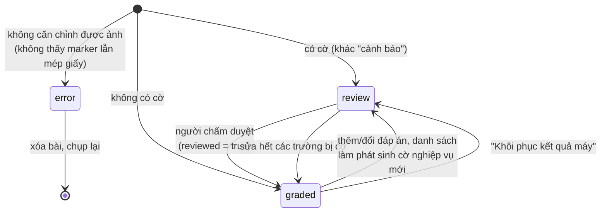

### 7.2 Các loại cờ

| `kind` | Nguồn | Khi nào | Chặn trạng thái "đã chấm"? |
|---|---|---|---|
| `blank` | máy đọc | chữ số SBD/mã đề không được tô | có |
| `multiple` | máy đọc | tô nhiều ô ở một câu / một chữ số | có |
| `uncertain` | máy đọc | ô sát ngưỡng, tô mờ, vết tẩy | có |
| `mismatch` | máy đọc | QR thuộc kỳ thi khác, hoặc số câu in trên phiếu khác kỳ thi | có |
| `warning` | máy đọc | chỉ căn chỉnh được theo mép giấy (không thấy marker), hoặc không có ô nào được tô rõ | **không** |
| `unknown_student` | nghiệp vụ | có danh sách thí sinh nhưng SBD không có trong đó | có |
| `duplicate` | nghiệp vụ | hai bài làm cùng SBD trong một kỳ thi | có |
| `unknown_code` | nghiệp vụ | mã đề đọc được không có đáp án | có |
| `no_key` | nghiệp vụ | kỳ thi chưa có đáp án nào | có |
| `error` | máy đọc | xử lý ảnh thất bại | (trạng thái `error`) |

### 7.3 Cờ được tính lại như thế nào — `grading.evaluate()`

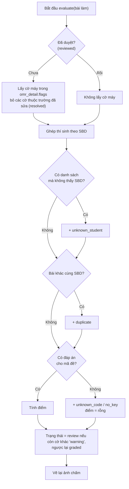

Vì vậy "đã duyệt" chỉ xóa cờ của máy. Các cờ nghiệp vụ (trùng SBD, sai mã đề…) **luôn còn** cho tới khi
nguyên nhân thực sự được xử lý.

---

## 8. Backend: API, bảo mật, lưu trữ

### 8.1 Danh sách API

Mọi endpoint (trừ đăng nhập và `/api/health`) yêu cầu cookie phiên. Tài liệu tương tác tự sinh tại
`http://127.0.0.1:8000/docs`.

**Xác thực & người dùng** — `routers/auth.py`

| Phương thức | Đường dẫn | Mô tả |
|---|---|---|
| POST | `/api/auth/login` | Đăng nhập, đặt cookie |
| POST | `/api/auth/logout` | Xóa cookie |
| GET | `/api/auth/me` | Người dùng hiện tại |
| POST | `/api/auth/password` | Đổi mật khẩu |
| GET / POST | `/api/users` | Danh sách / tạo tài khoản (admin) |
| DELETE | `/api/users/{id}` | Xóa tài khoản (admin) |

**Kỳ thi** — `routers/exams.py`

| Phương thức | Đường dẫn | Mô tả |
|---|---|---|
| GET / POST | `/api/exams` | Danh sách (kèm số liệu tóm tắt) / tạo |
| GET / PUT / DELETE | `/api/exams/{id}` | Xem / sửa (không cho đổi số câu khi đã có bài) / xóa |
| GET | `/api/exams/{id}/sheet.pdf` | Phiếu PDF; `?copies=N` hoặc `?personalized=true` |
| GET | `/api/exams/{id}/sheet.png` | Ảnh xem trước phiếu |
| GET / POST | `/api/exams/{id}/keys` | Danh sách / tạo-hoặc-ghi-đè đáp án một mã đề |
| DELETE | `/api/exams/{id}/keys/{key_id}` | Xóa mã đề |
| POST | `/api/exams/{id}/keys/import` | Nhập đáp án từ .xlsx/.csv |
| POST | `/api/exams/{id}/keys/from-sheet` | Đọc đáp án từ ảnh phiếu giáo viên tô (chưa lưu) |
| GET | `/api/exams/{id}/keys/template.xlsx` | File mẫu đáp án |
| GET / POST | `/api/exams/{id}/students` | Danh sách (kèm điểm) / thêm thí sinh |
| PUT / DELETE | `/api/exams/{id}/students/{sid}` | Sửa / xóa thí sinh |
| POST | `/api/exams/{id}/students/import` | Nhập danh sách; `?replace=true` để thay toàn bộ |
| GET | `/api/exams/{id}/students/template.xlsx` | File mẫu danh sách |
| GET | `/api/exams/{id}/stats` | Thống kê; `?code=101` chọn mã đề cho phân tích câu hỏi |
| GET | `/api/exams/{id}/export.xlsx` | Xuất Excel |
| GET | `/api/exams/{id}/activity` | Nhật ký hoạt động của kỳ thi |

**Bài làm** — `routers/submissions.py`

| Phương thức | Đường dẫn | Mô tả |
|---|---|---|
| POST | `/api/exams/{id}/submissions` | Tải ảnh/PDF lên và chấm (multipart `files`) |
| GET | `/api/exams/{id}/submissions` | Danh sách; `?status=review` `?q=...` |
| GET | `/api/submissions/{id}` | Chi tiết + `omr_detail` + đáp án đúng |
| GET | `/api/submissions/{id}/neighbors` | Bài trước/sau (dùng khi duyệt nhanh) |
| PATCH | `/api/submissions/{id}` | Sửa SBD/mã đề/đáp án, đánh dấu đã duyệt |
| POST | `/api/submissions/{id}/reset` | Khôi phục kết quả máy đọc |
| DELETE | `/api/submissions/{id}` | Xóa bài làm và ảnh |
| GET | `/api/submissions/{id}/history` | Lịch sử chỉnh sửa |
| GET | `/api/submissions/{id}/image/{kind}` | Ảnh `original` / `warped` / `annotated` |

**Phòng thí nghiệm & khác** — `routers/lab.py`, `routers/dashboard.py`

| Phương thức | Đường dẫn | Mô tả |
|---|---|---|
| POST | `/api/lab/analyze` | Chạy pipeline, trả ảnh + số liệu từng bước (không lưu) |
| POST | `/api/lab/detect` | Chỉ tìm marker — cho webcam |
| GET | `/api/lab/sample` | Sinh một ảnh phiếu mẫu ngẫu nhiên |
| POST | `/api/exams/{id}/demo?n=20` | Sinh thí sinh, đáp án, ảnh bài làm giả và chấm |
| GET | `/api/dashboard` | Số liệu trang Tổng quan |
| GET | `/api/health` | Kiểm tra server sống |

### 8.2 Bảo mật

| Vấn đề | Cách xử lý | Ở đâu |
|---|---|---|
| Lưu mật khẩu | PBKDF2-HMAC-SHA256, 200 000 vòng, muối ngẫu nhiên 16 byte | `security.hash_password` |
| Phiên đăng nhập | Token = `base64(JSON{uid, exp}) + "." + HMAC-SHA256(khóa bí mật)`, hạn 7 ngày | `security.make_token` |
| Lưu token phía trình duyệt | Cookie `omr_session`, `HttpOnly` (JavaScript không đọc được), `SameSite=Lax` | `routers/auth.login` |
| Khóa bí mật | Tự sinh lần đầu vào `data/secret.key`, hoặc biến môi trường `OMR_SECRET_KEY` | `config._secret_key` |
| Phân quyền | `admin` thấy mọi kỳ thi; `teacher` chỉ thấy kỳ thi mình tạo. Mọi endpoint có `exam_id` đều đi qua `get_exam_for()` | `security.get_exam_for` |
| Đọc file ảnh | Đường dẫn ảnh được chuẩn hóa và bắt buộc nằm trong `data/uploads/` (chặn `../`) | `grading.image_path` |
| Kích thước tải lên | Tối đa 40 MB mỗi file | `routers/submissions.upload` |
| Dữ liệu vào | Pydantic kiểm tra kiểu, độ dài, mẫu (SBD 6 số, mã đề 3 số…) | `schemas.py` |

Phù hợp cho dùng trong một trường/một mạng nội bộ. Nếu đưa lên Internet cần thêm HTTPS, giới hạn số lần đăng nhập
sai và đổi mật khẩu admin mặc định.

### 8.3 Lưu trữ

```
data/
├── app.db                         CSDL SQLite (chế độ WAL, bật khóa ngoại)
├── secret.key                     khóa ký cookie
└── uploads/
    └── exam_{id}/
        ├── sub_{id}_orig.jpg      ảnh gốc, thu nhỏ ≤ 2000 px, JPEG 88
        ├── sub_{id}_warp.jpg      ảnh đã nắn 1260×1782, JPEG 92 — nền cho lớp phủ duyệt bài
        └── sub_{id}_annot.jpg     ảnh chấm (vẽ lại mỗi khi điểm thay đổi)
```

Muốn sao lưu toàn bộ hệ thống: sao chép thư mục `data/`. Muốn làm lại từ đầu: xóa thư mục đó.

---

## 9. Frontend

### 9.1 Sơ đồ trang

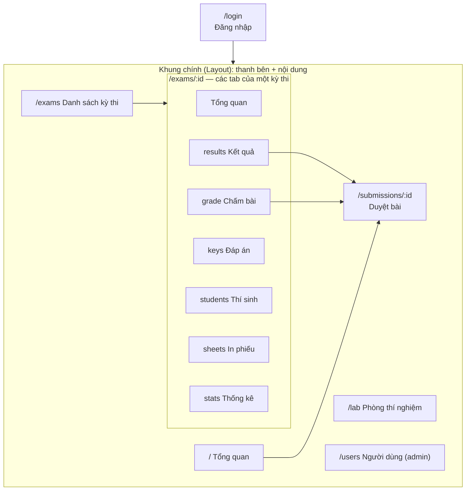

`RequireAuth` (trong `App.tsx`) bọc toàn bộ khung chính: chưa đăng nhập thì chuyển về `/login` và nhớ trang đang
muốn vào.

### 9.2 Quản lý dữ liệu

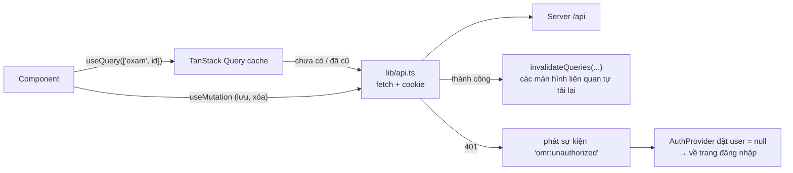

- Mọi dữ liệu từ server đi qua TanStack Query, khóa cache theo dạng `["exam", id]`, `["submissions", examId]`,
  `["stats", examId, code]`… Sau khi sửa dữ liệu, chỉ cần báo "khóa này đã cũ", các màn hình đang hiển thị nó tự cập nhật.
- `lib/api.ts` gom việc gọi HTTP: gửi cookie, đổi lỗi của FastAPI thành câu thông báo tiếng Việt, và `upload()` dùng
  XMLHttpRequest để có tiến độ tải lên.
- Trạng thái cục bộ (đang sửa đáp án nào, mức zoom…) để trong `useState` của từng trang.

### 9.3 Các màn hình đáng chú ý

| Màn hình | Kỹ thuật |
|---|---|
| Chấm bài — tải lên | Hàng đợi giữ trong `useRef`, gửi song song tối đa 3 file, mỗi file một request để có tiến độ và kết quả riêng |
| Chấm bài — webcam | `getUserMedia` → vẽ khung hình lên canvas → gửi bản 720 px tới `/lab/detect` ~3 lần/giây → vẽ khung phiếu lên canvas phủ trên video → đủ ổn định thì chụp bản 2400 px và tải lên |
| Duyệt bài | Ảnh đã nắn đặt trong `<svg>` có `viewBox` bằng kích thước ảnh; mỗi ô là một `<circle>` đặt đúng tâm trong `omr_detail` → bấm để chọn/bỏ; điểm tạm tính ngay trên trình duyệt; phím tắt Ctrl+S, Ctrl+Enter, Alt+←/→ |
| Đáp án | Lưới câu hỏi điều khiển bằng bàn phím: gõ A–F để chọn và nhảy câu, mũi tên để di chuyển |
| Phòng thí nghiệm | Hiển thị lần lượt các bước server trả về (ảnh base64 + mô tả + thời gian), biểu đồ dãy độ sáng đã sắp xếp với đường ngưỡng |

### 9.4 Giao diện

Bảng màu và font khai báo tập trung trong `frontend/src/index.css` (khối `@theme` của Tailwind 4): nền giấy ấm,
chữ màu mực, một màu nhấn đỏ son; màu ngữ nghĩa *đúng / sai / cần xem* = xanh lá đậm / đỏ son / vàng đất. Tiêu đề
và số liệu lớn dùng font có chân (Source Serif 4), SBD và mã đề dùng font đơn cách (IBM Plex Mono). Toàn bộ
component dùng chung ở `components/ui.tsx` — đổi phong cách ở đó là đổi cho cả ứng dụng.

---

## 10. Kiểm thử và đánh giá

| Loại | Lệnh | Kiểm tra gì |
|---|---|---|
| Kiểm thử API toàn luồng | `python -m pytest tests -q` | Đăng nhập → tạo kỳ thi → in phiếu → nhập đáp án + danh sách → chấm ảnh → sửa tay → thống kê → xuất Excel; dữ liệu demo; phòng thí nghiệm; chặn truy cập khi chưa đăng nhập. Chạy trên CSDL tạm, không đụng dữ liệu thật |
| Đánh giá độ chính xác | `python -m tools.evaluate --n 150 --questions 120` | Sinh 150 ảnh tổng hợp có đáp án, đo tỉ lệ căn chỉnh, đọc đúng SBD/mã đề/từng câu, câu sai lọt cờ, cờ báo nhầm, phát hiện tô nhiều ô và vết tẩy, thời gian |
| Đánh giá trên ảnh thật | `python -m tools.evaluate --eval-only --out dataset/real` | Như trên, với ảnh tự chụp + `truth.json` tự gán nhãn |
| So sánh với OMRChecker | `python -m tools.omrchecker_baseline` | Tự sinh `template.json` cho OMRChecker từ `layout.py`, chạy nó bằng subprocess trên cùng ảnh, so sánh kết quả |

Kết quả hiện tại (dữ liệu tổng hợp): 100% căn chỉnh, 100% đọc đúng từng câu, 0 câu sai lọt cờ, 0% cờ báo nhầm,
~150 ms/phiếu. So với OMRChecker trên 104 ảnh không xoay: xử lý được 100% so với 72%, phiếu đúng hoàn toàn 100% so
với 58%. Chi tiết và lưu ý khi trình bày xem `README.md`.

---

## 11. Chạy, cấu hình, triển khai

### 11.1 Chạy

```bash
pip install -r requirements.txt
cd frontend && npm install && npm run build && cd ..
python run.py                     # http://127.0.0.1:8000
python -m tools.seed_demo         # (tùy chọn) dữ liệu demo
```

Khi phát triển giao diện: `python run.py --reload` và `cd frontend && npm run dev` (cổng 5173, tự chuyển `/api` sang
cổng 8000). Khi phát triển lõi xử lý ảnh không cần chạy web: viết thử trong Python rồi chạy `tools/evaluate.py`.

### 11.2 Biến môi trường

| Biến | Mặc định | Ý nghĩa |
|---|---|---|
| `OMR_DATA_DIR` | `./data` | thư mục CSDL + ảnh |
| `OMR_DATABASE_URL` | `sqlite:///data/app.db` | chuỗi kết nối CSDL (SQLAlchemy) |
| `OMR_SECRET_KEY` | tự sinh vào `data/secret.key` | khóa ký cookie |
| `OMR_ADMIN_USER` / `OMR_ADMIN_PASSWORD` | `admin` / `admin123` | tài khoản tạo lần đầu khi CSDL trống |

### 11.3 Truy cập từ máy khác

`python run.py --host 0.0.0.0` để máy khác trong cùng mạng LAN mở được qua `http://<IP-máy-chủ>:8000`. Trình duyệt
chỉ cho dùng camera trên `localhost` hoặc HTTPS; trên điện thoại qua LAN hãy dùng nút *Tải ảnh lên* (trình duyệt
cho phép chụp ảnh trực tiếp từ nút chọn file).

---

## 12. Giới hạn đã biết và hướng mở rộng

**Giới hạn**

- Độ chính xác mới được đo trên **dữ liệu tổng hợp**; cần bổ sung ảnh chụp thật để có số liệu đáng tin cho báo cáo.
- Chỉ đọc được phiếu do chính hệ thống sinh ra (bố cục cố định trong `layout.py`).
- Khi một marker góc bị che hoặc rách, hệ thống chỉ còn cách căn theo mép tờ giấy: cần nền tương phản với
  giấy và độ chính xác thấp hơn (bài bị gắn cảnh báo, độ tin cậy giảm).
- Chấm đồng bộ trong request: phù hợp vài trăm phiếu; quy mô lớn hơn nên đưa vào hàng đợi chạy nền.
- SQLite phù hợp một máy chủ; nhiều người ghi đồng thời với tải cao nên chuyển sang PostgreSQL (chỉ cần đổi
  `OMR_DATABASE_URL`).

**Hướng mở rộng**

| Ý tưởng | Hướng làm |
|---|---|
| Chịu được mất một marker | Từ 3 marker tìm được, ước lượng góc thứ tư bằng phép biến đổi affine rồi kiểm chứng như bước 2c |
| Phân loại ô bằng học máy | Cắt ảnh từng ô từ dữ liệu đã duyệt (đã có nhãn đúng), huấn luyện CNN nhỏ (đã có PyTorch) phân biệt tô / trống / tẩy / gạch chéo; dùng khi ngưỡng không chắc chắn |
| Bố cục phiếu tùy biến | Cho phép nhiều mẫu phiếu; lưu mã mẫu trong QR (đã có trường `layout_version`) |
| Câu hỏi đúng/sai, điền số | Thêm loại khối mới trong `layout.py` + quy tắc diễn giải trong `pipeline.py` |
| Chấm hàng loạt lớn | Hàng đợi nền (RQ / Celery) + thông báo tiến độ qua WebSocket |
| Gửi kết quả cho thí sinh | Trang tra cứu điểm theo SBD + mã bảo mật |
